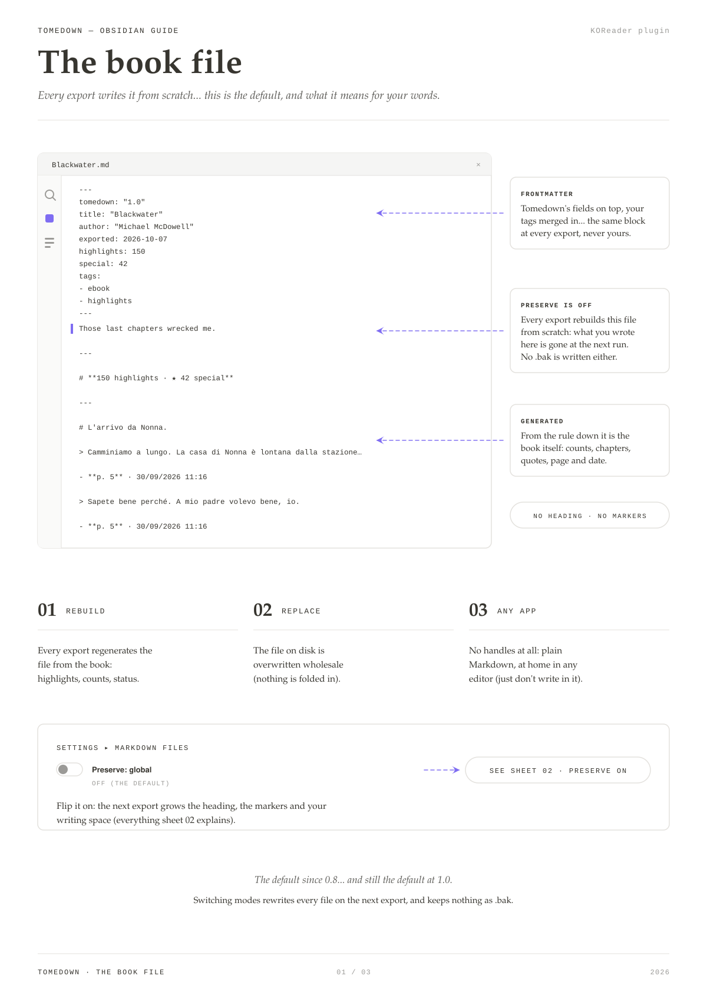
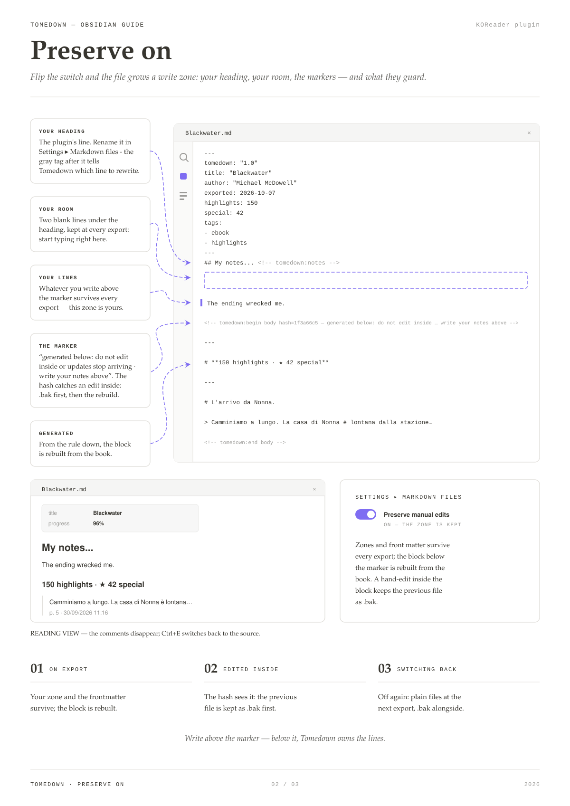
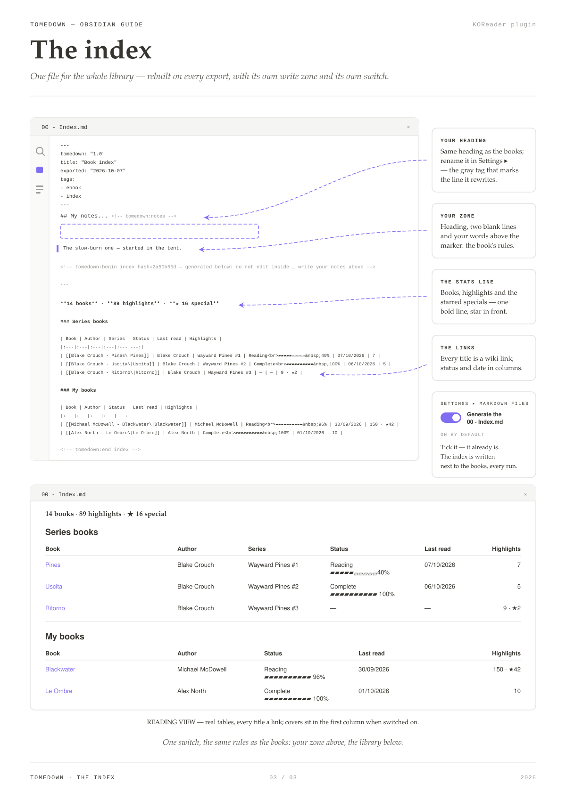

# Obsidian guide: the files as they sit in the vault

Three sheets on what Tomedown writes into your vault: the book file as
every export produces it by default, the same file with *Keep my notes:
all books* on, and the index that ties the library together. A last
section shows how a quote gets an id of its own and can be linked on its
own. The [quickstart](README.md#quickstart) shows the flow end to end;
this page zooms into the file itself. Nothing here needs anything
installed in Obsidian — the files are plain Markdown either way.

## The book file, as exported (default)

The frontmatter, then straight into the generated block: no heading, no
markers, no comments — nothing to hide from any Markdown app, which is
the point of the default. The flip side is in the sheet's second callout:
every export rebuilds the file from scratch, so anything you write in it
is gone at the next run. If you want to write, flip *Keep my notes: all books*
(Settings → My notes) and read sheet 02 before the next export.

## With *Keep my notes: all books* on

The file grows a write zone: the heading with its gray tag (rename the
heading in Settings → My notes, the tag stays), two blank lines of room, and
your words above the marker. Below the marker the plugin owns the lines
and rebuilds them from the book; an edit made *inside* the block is caught
by the hash in the marker and the previous file comes back as `.bak`. In
reading view the comments and markers disappear (`Ctrl+E` switches back
to the source), and switching the toggle off again rewrites every file
plain on the next export — each current one kept as `.bak`.

## The index

`00 - Index.md` is one file for the whole library: a stats line (books,
highlights, starred specials), then the series books and the rest, each
title a wiki link that opens that book's own note, with a Status column
holding the reading status over the progress bar, the percentage glued
to the bar so it never wraps to a line of its own, and a Last read
column with the date it was last opened. It is generated by
*Create an index note (00 - Index.md)* (Settings → My notes),
**on by default**, and it plays by the same rules as the books: heading,
room and your words above the marker survive every export, the tables
below are rebuilt.

## Link to a single highlight

Flip *Add link IDs to highlights* (Settings → Highlights for Obsidian)
and every quote ends with an id of its own on its last line, `^hl-` and
eight characters:

> First highlighted sentence. ^hl-4f2a9c31

The id belongs to the highlight rather than to the export, so it stays
put: the same quote keeps it through every re-export, and a link written
once keeps working. `[[Book title#^hl-4f2a9c31]]` jumps to that one
quote from anywhere in the vault, `![[Book title#^hl-4f2a9c31]]` embeds
the quote into the page you are writing. The toggle is off by default,
and the apps that ignore ids show `^hl-4f2a9c31` as plain text at the
end of the quote.

## See also

- [README — Keep my notes](README.md#keep-my-notes): the
  setting, the merge and the `.bak` files, step by step.
- [README — Obsidian (optional)](README.md#obsidian-optional): the cloud
  setup with Remotely Save, from zero to a synced vault.
- [SYNC-DIRECTION.md](SYNC-DIRECTION.md): which Remotely Save sync
  direction to pick, and where your edits live.
- [TUTORIAL.md](TUTORIAL.md): the same flow as a full tutorial.
