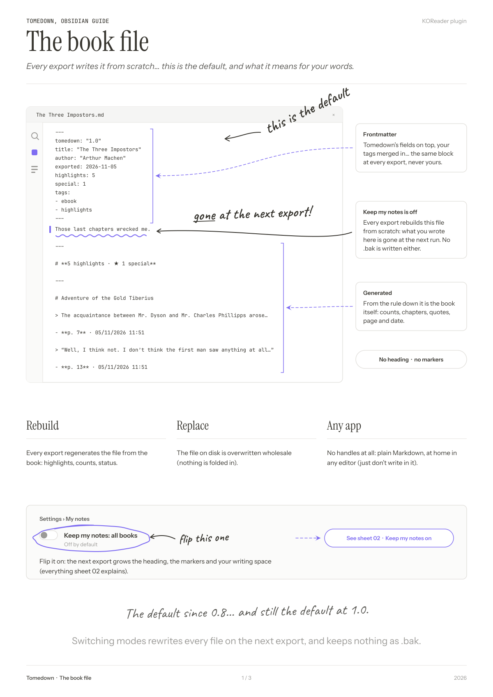
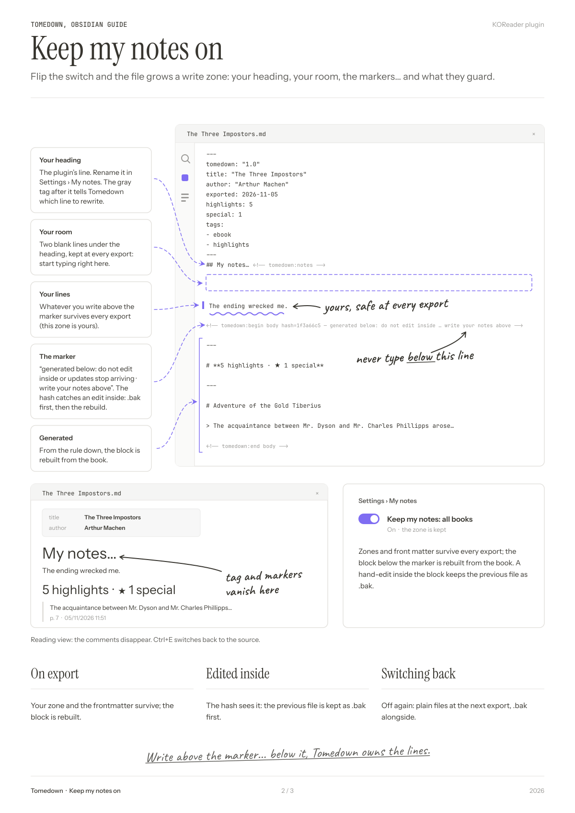
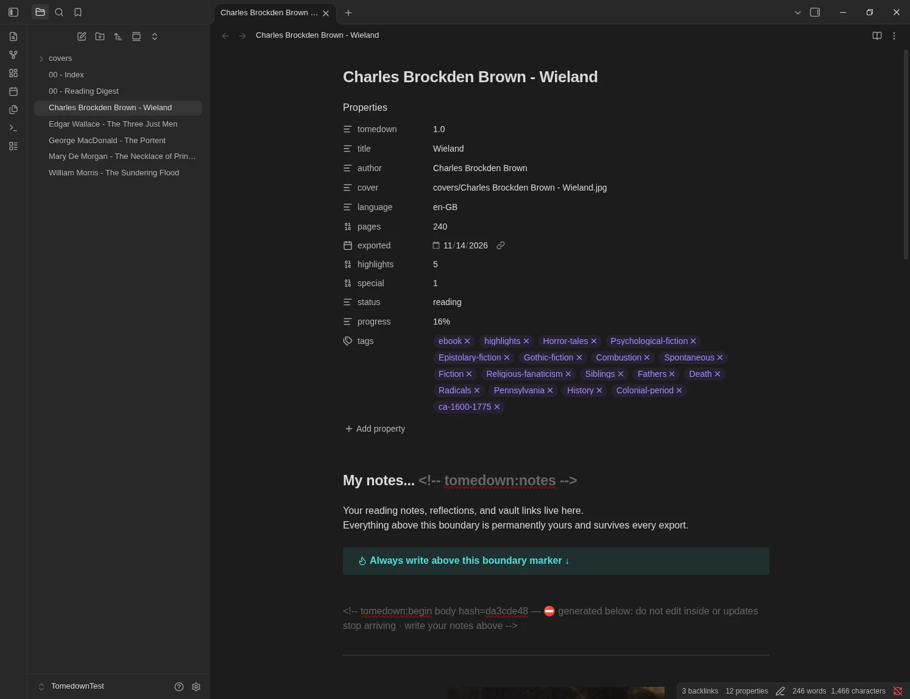
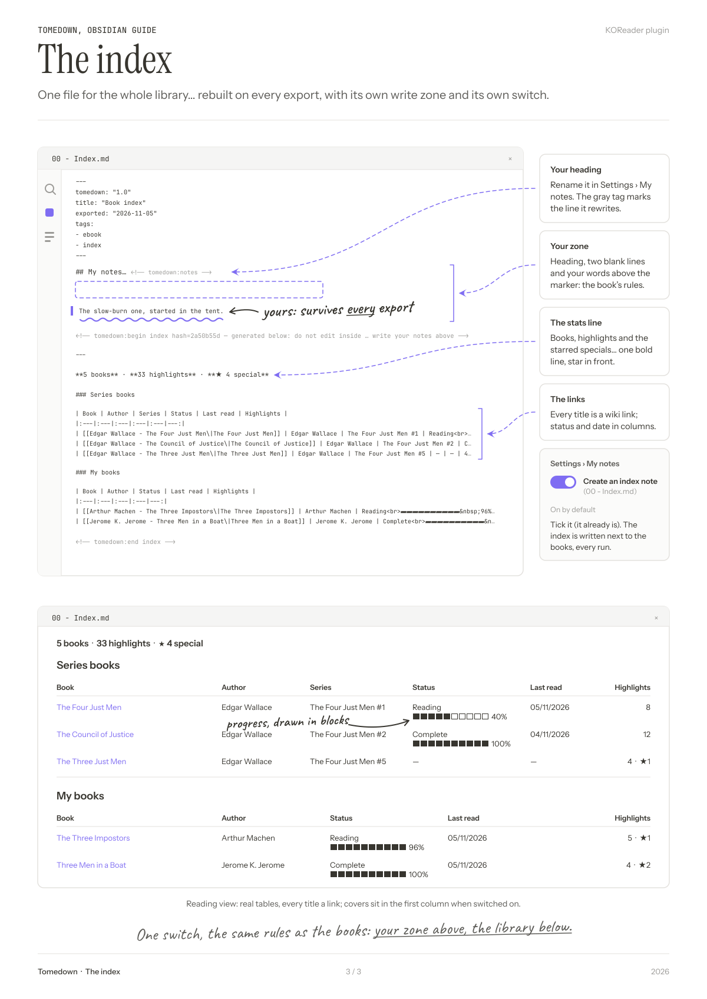
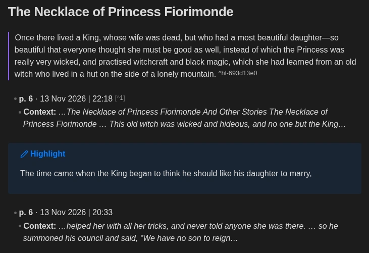

# Obsidian guide: your notes inside the vault

A visual guide to how exported books, reading progress, and index tables look and function inside an Obsidian vault.

For full technical specifications of the generated Markdown, YAML properties, and index tables, see the [File format & specifications](docs/file-format.md) page.

## The book note in Obsidian

Every exported book note is a self-contained Markdown file ready for Obsidian.

<!-- SCREENSHOT_PLACEHOLDER: assets/obsidian/book_note_v210.png -->
> [!NOTE] **[SCREENSHOT DA REALIZZARE: Scheda Libro con Dashboard e Sinossi in Obsidian]**
> - **File di destinazione:** `assets/obsidian/book_note_v210.png`
> - **Inquadratura:** Visualizzazione di una nota libro esportata (es. `Arthur Machen - The Three Impostors.md`) in Obsidian (Reading View o Live Preview).
> - **Elementi da mostrare:**
>   - Proprietà frontmatter in alto.
>   - Intestazione H1 con titolo `# The Three Impostors` e H3 `### by Arthur Machen`.
>   - Bacheca di lettura (`> [!book]`) con stato, stelle, date e link all'indice.
>   - Sinossi collassabile (`> [!abstract]- Synopsis`).
>   - Box Panoramica (es. `> [!summary] Overview` o tabella).
>   - Citazioni con formato data/ora letterario: `- **p. 15** · 16 Nov 2026 | 10:20`.

- **Reading View vs. Live Preview**: in Reading View, YAML frontmatter renders cleanly as Obsidian Properties, and internal Tomedown hashes stay out of sight.
- **Embedded Covers**: when *Include book covers* is enabled, covers are stored in your vault folder (default `covers/`) and render natively in Obsidian (requires Obsidian 1.8.1 or newer).
- **Wikilinks**: internal references connect book titles directly across your notes.

## Personal notes with *Keep my notes*

Enable **Tomedown → Settings → My notes → Keep my notes: all books** (or per book in the book menu) to turn exported files into shared workspaces.

<figure class="doc-shot">
  

    
  

  <figcaption>Personal notes written in <code>## My notes...</code> survive every export — the boundary marker protects your writing.</figcaption>
</figure>

1. **Write freely**: write reflections, permanent notes, and synthesis directly under the `## My notes...` section.
2. **Resilient merging**: when you take new highlights on your e-reader, Tomedown folds them into the generated section below without touching a single word of your manual notes.
3. **Safety copies**: if content inside the generated block is ever altered unexpectedly, Tomedown creates a `.bak` backup copy before merging. For a complete deep dive, see [Keep my notes](docs/keep-my-notes.md).

## The Library Index (`00 - Index.md`)

`00 - Index.md` acts as your personal bookshelf dashboard in Obsidian.

- **Interactive table**: click any book title or cover to navigate straight to that book note.
- **Visual reading progress**: 5-cell Unicode indicators (`▰▰▰▰▰`) display exact completion percentages without breaking columns.
- **Stacked tag pills**: subject tags stack vertically as clean pills, preventing table widening.
- **Customizable views**: choose between *Tags under the title*, *Tags column*, or *Tags column, compact* in *Settings → Index*.

<!-- SCREENSHOT_PLACEHOLDER: assets/obsidian/index_v210_trophy_dashboard.png -->
> [!NOTE] **[SCREENSHOT DA REALIZZARE: Indice Completo con Trofei e Dashboard in Obsidian]**
> - **File di destinazione:** `assets/obsidian/index_v210_trophy_dashboard.png`
> - **Inquadratura:** Visualizzazione di `00 - Index.md` in Obsidian (Reading View).
> - **Elementi da mostrare:**
>   - La bacheca riepilogativa della libreria (Library Dashboard).
>   - La sezione *Completed books* con stelle e date.
>   - La tabella principale con le copertine dei libri.
>   - La sezione *Tag cloud* in fondo alla pagina con i tag cliccabili.

## Reading Digest (00 - Reading Digest.md)

A consolidated chronological reading journal grouping all highlights across your whole library by day:

<!-- SCREENSHOT_PLACEHOLDER: assets/obsidian/reading_digest_v210.png -->
> [!NOTE] **[SCREENSHOT DA REALIZZARE: Reading Digest in Obsidian]**
> - **File di destinazione:** `assets/obsidian/reading_digest_v210.png`
> - **Inquadratura:** Visualizzazione di `00 - Reading Digest.md` in Obsidian (Reading View o Live Preview).
> - **Elementi da mostrare:**
>   - Intestazione H1 `# Reading digest` e citazione poetica iniziale.
>   - Statistiche complessive (es. `2 books · 25 highlights · ★ 4 special`).
>   - Intestazione giorno letteraria: `## 16 Nov 2026`.
>   - Due libri diversi letti nello stesso giorno, separati dal divisore `---`.
>   - Metadati citazione orari: `*Chapter* · **p. X** · 09:41`.

## Handwritten notes & Stylus drawings

For stylus devices, handwritten notes are rendered as pure SVG vector strokes or PNGs in `drawings/` and embedded seamlessly inside your book notes:

<!-- SCREENSHOT_PLACEHOLDER: assets/obsidian/handwritten_drawing_embed.png -->
> [!NOTE] **[SCREENSHOT DA REALIZZARE: Nota a Mano Libera / Disegno Stylus in Obsidian]**
> - **File di destinazione:** `assets/obsidian/handwritten_drawing_embed.png`
> - **Inquadratura:** Zoom su una nota libro in Obsidian contenente un disegno o annotazione a penna.
> - **Elementi da mostrare:**
>   - L'immagine vettoriale SVG integrata tra le citazioni.
>   - La riga metadati con icona: `- **p. 25** · 16 Nov 2026 | 12:05 · ✍️ Handwritten note`.
>   - L'eventuale nota testuale associata: `NOTE: Margin sketch`.
>   - Il block ID Obsidian `^hl-...`.

## Link to a single highlight

Enable **Settings → Style → Add link IDs to highlights** to attach stable block IDs (`^hl-xxxxxxxx`) to every quote:

<figure class="doc-shot">
  

    
  

  <figcaption>Each quote gets a stable <code>^hl-xxxxxxxx</code> block ID in Obsidian.</figcaption>
</figure>

Because block IDs are tied to quote hashes, they persist across future re-exports:

- **Jump to a highlight**: `[[Book title#^hl-dfd750fa]]` opens the note directly focused on that quote.
- **Transclude anywhere**: `![[Book title#^hl-dfd750fa]]` embeds the quote live into any other note or daily journal in your vault.

## Syncing with your vault

To sync notes automatically between your e-reader and Obsidian on computer or mobile:

- Follow the step-by-step [Setup tutorial (Koofr & Remotely Save)](TUTORIAL.md) to connect via WebDAV.
- Read [Sync direction guide](SYNC-DIRECTION.md) to understand how bidirectional sync keeps your notes safe.
- [README](README.md): installation, the menu, settings and file format.
