<p align="center">
  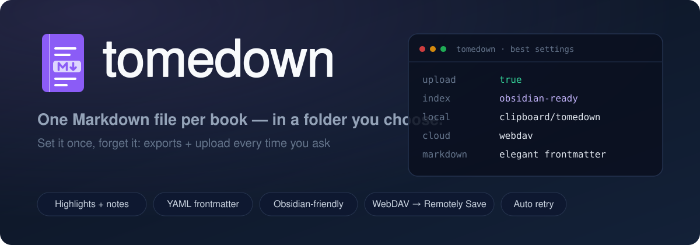
</p>

<p align="center">
  <a href="https://ko-fi.com/imanubdesigner"></a>
  
  
  
  
</p>

<p align="center">
  <a href="https://github.com/imanubdesigner/tomedown.koplugin/releases/latest"></a>
  <a href="https://github.com/imanubdesigner/tomedown.koplugin/actions/workflows/test.yml"></a>
  <a href="LICENSE"></a>
</p>

## Contents

- [Quickstart](#quickstart)
- [Requirements](#requirements)
- [Compatibility](#compatibility)
- [Installation](#installation)
- [Configuration (one-off)](#configuration-one-off)
  - [If you already use AnnotationSync](#if-you-already-use-annotationsync)
  - [Updates](#updates)
- [Usage](#usage)
  - [Special highlights](#special-highlights)
  - [Block IDs and linking](#block-ids-and-linking)
  - [Auto-export and offline reading](#auto-export-and-offline-reading)
  - [Upload retries](#upload-retries)
  - [Preserve your edits](#preserve-your-edits)
  - [Editing in Obsidian while the device is away](#editing-in-obsidian-while-the-device-is-away)
- [File format](#file-format)
- [Obsidian (optional)](#obsidian-optional)
- [Notes and limitations](#notes-and-limitations)
- [Languages (English / Italian)](#languages-english--italian)
- [Debug](#debug)
- [Tests](#tests)
- [Project structure](#project-structure)
- [Support](#support)
- [License](#license)

A KOReader plugin that exports the highlights of **each book into its own
`.md` file**, with YAML frontmatter and an automatic index. Everything is
written to a folder on the device first (`clipboard/tomedown`, changeable);
uploading to **your cloud** (any WebDAV server, or Dropbox/FTP) is an
option, and so is reading the notes in Obsidian.

I wrote Tomedown for my own Kindle, because I wanted one file per book and
no app in the middle. It has been in daily use since, and most of what
changed in these releases comes from reading my own library, and from
people who took the time to report what did not work.

The examples in this repo use **Koofr**: its free plan gives you 10 GB,
more than enough for a whole library of `.md` files.

Unlike *Export highlights and notes* (which produces a single combined file),
every volume stays separate:

```
/mnt/us/koreader/clipboard/tomedown/
├── 00 - Index.md
├── Michael McDowell - Blackwater_ The Complete Saga.md
└── ...
```

## Quickstart

From the first highlight to a note you keep, in six sheets: the cover
and one sheet per step. Start with **01**.

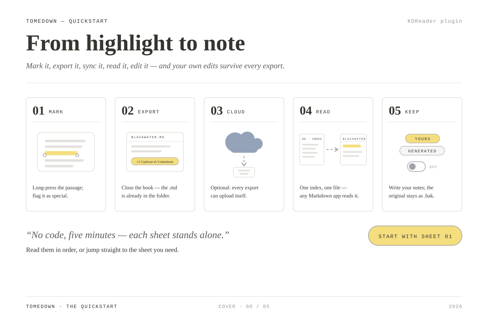

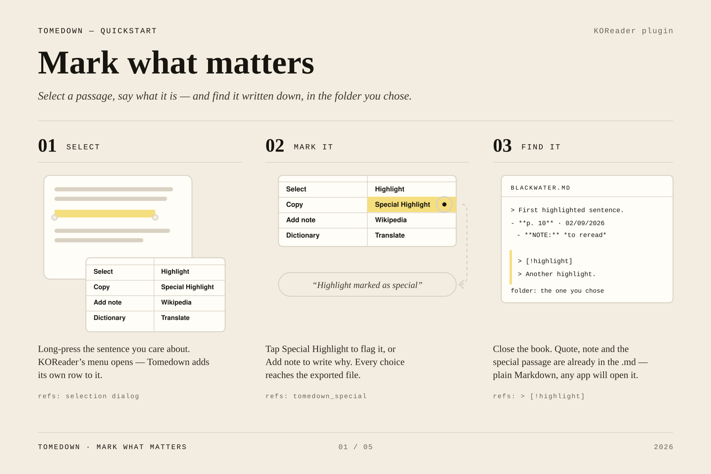

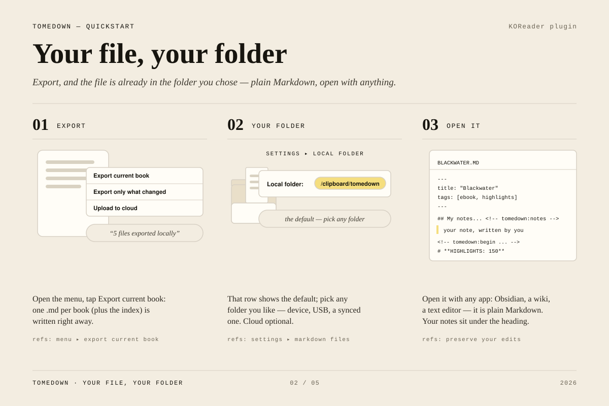

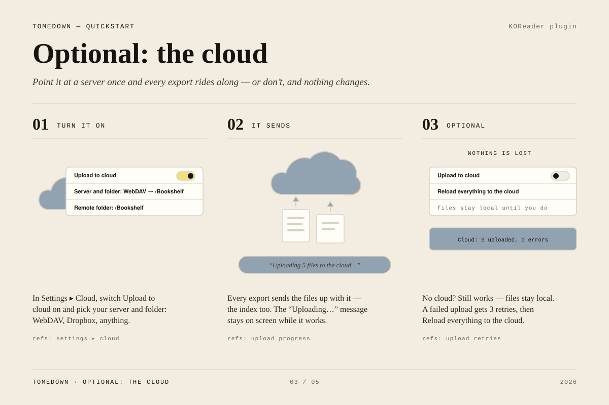

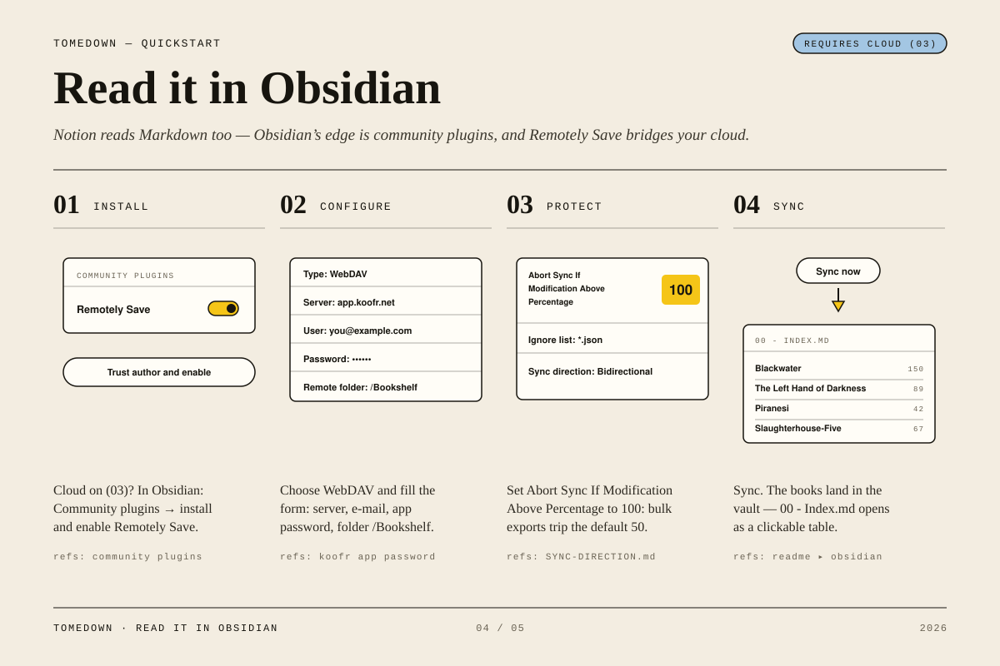

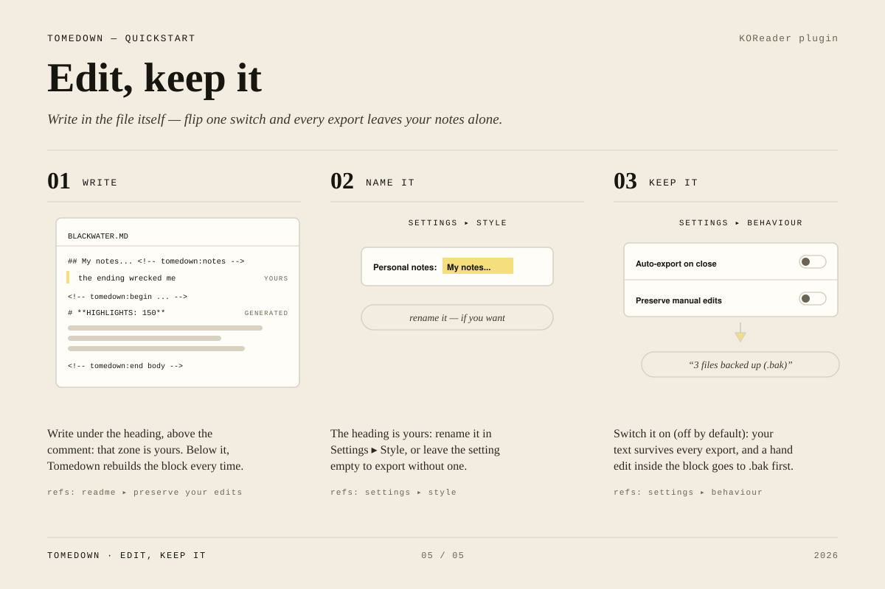

Once the files are in your vault, the
[Obsidian guide](OBSIDIAN.md) shows what you are looking at: the book
file with and without Preserve, and the index.

## Requirements

- KOReader with highlights in the modern format (old `.sdr` files, where
  highlights live in `highlight` + `bookmarks`, are supported too)
- The **Cloud storage** plugin that ships with KOReader, with any server it
  supports (WebDAV, Dropbox, FTP). The examples use Koofr's WebDAV:
  `https://app.koofr.net/dav/Koofr`
  (Koofr's documented WebDAV host: the plain `/dav/` root is not writable).
  **No cloud at all?** The local export works anyway
- Optional, to read the notes in Obsidian: **Remotely Save** with a WebDAV
  server (free). Any other Markdown app works too

## Compatibility

Tested on:

- **Kindle Paperwhite 5**, KOReader 2026.07.2, in daily use
- **Kindle 4 Non-Touch**, KOReader 2026.07.1 with Nextcloud WebDAV and
  Obsidian, [tested and reported by Tewel](https://codeberg.org/imanubdesigner/tomedown.koplugin/issues/1#issuecomment-25359526):
  online merge, the offline round trip and the Obsidian edits, all
  verified on beta 2, with the merge code unchanged since

The plugin is plain Lua: it runs wherever KOReader runs and touches no
hardware. The local export needs no network at all.

## Installation

A full walkthrough (cloud account and app password, Koofr as the example;
first export; optional Remotely Save in Obsidian) is in
[TUTORIAL.md](TUTORIAL.md).

1. Plug the Kindle in via USB mass storage.
2. Get the plugin into `/mnt/us/koreader/plugins/`, either way:

   **a. Release zip (easiest)**: download `tomedown.koplugin-v*.zip` from the
   [Releases](https://github.com/imanubdesigner/tomedown.koplugin/releases)
   page and unzip it *into* that folder: the zip already contains the
   `tomedown.koplugin/` directory.

   **b. From a clone of this repo**: copy the folder, leaving behind what
   KOReader does not need (tests, docs, git files and the guide artwork;
   the logo stays, the About popup shows it):

   ```
   rsync -a --exclude tests --exclude .git --exclude .github \
         --exclude .gitattributes --exclude .gitignore \
         --exclude README.md --exclude README.codeberg.md \
         --exclude TUTORIAL.md --exclude TUTORIAL.codeberg.md \
         --exclude OBSIDIAN.md --exclude SYNC-DIRECTION.md \
         --exclude assets/menu --exclude assets/obsidian \
         --exclude assets/obsidian-guide --exclude assets/tutorials \
         --exclude assets/banner.svg \
         tomedown.koplugin /mnt/us/koreader/plugins/
   ```

   Either way the result should look like:

   ```
   /mnt/us/koreader/plugins/tomedown.koplugin/main.lua
   /mnt/us/koreader/plugins/tomedown.koplugin/tomedown_i18n.lua
   /mnt/us/koreader/plugins/tomedown.koplugin/tomedown_render.lua
   /mnt/us/koreader/plugins/tomedown.koplugin/_meta.lua
   /mnt/us/koreader/plugins/tomedown.koplugin/languages/it.po
   /mnt/us/koreader/plugins/tomedown.koplugin/assets/logo.svg
   /mnt/us/koreader/plugins/tomedown.koplugin/LICENSE
   ```

3. Unplug the Kindle and restart KOReader (or: ☰ menu → *Plugin management* →
   enable *Tomedown*).
4. **Tomedown** is the first entry of KOReader's menu: on top of the
   *Navigation* tab (right before *Table of Contents*) while reading, on
   top of the first tab in the file browser (right before *Display mode*):

   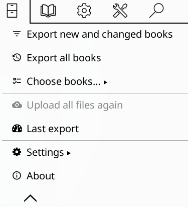

   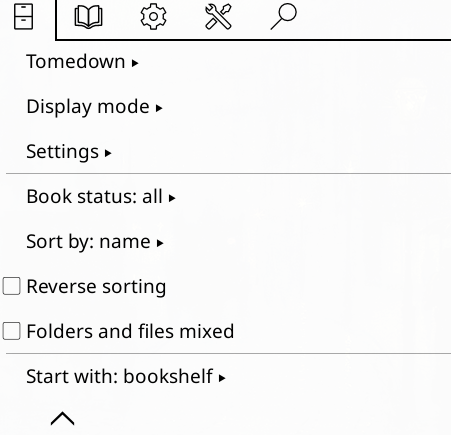

## Configuration (one-off)

☰ menu → **Tomedown** → **Settings**, in four groups:

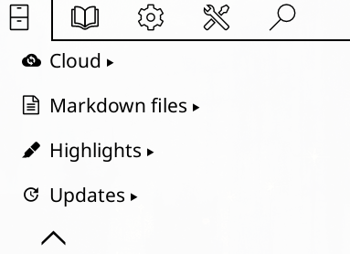

**Cloud**

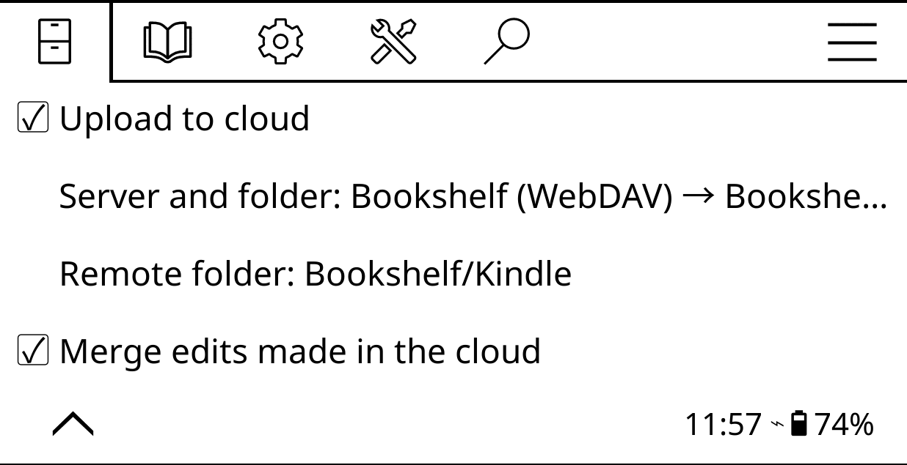

| Entry | What to do |
|---|---|
| *Upload to cloud* | any WebDAV/Dropbox/FTP server works; on by default for installs that have already exported, off on a fresh install |
| *Server and folder…* | opens the Cloud storage browser: pick your server (the examples use Koofr), then navigate to the final folder (e.g. `Bookshelf/Kindle`) and tap **Choose** |
| *Remote folder…* | only if you want to override the folder chosen above (e.g. `/Bookshelf/Kindle`) |

**Markdown files**

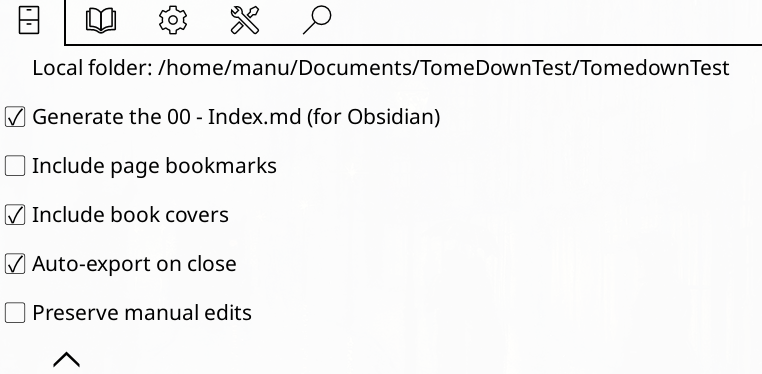

| Entry | What to do |
|---|---|
| *Local folder* | defaults to `clipboard/tomedown` inside KOReader's data folder; tap it to browse with KOReader's folder picker (long-press a folder to choose it) |
| *Generate the 00 - Index.md (for Obsidian)* | builds the Obsidian tables: a stats line on top, then series books and the rest, each with the columns it actually has (links, author, series, highlights with stars, status over the progress bar, last read) |
| *Include page bookmarks* | off by default: adds a `# Page bookmarks` section (bookmarked page + note) after the highlights |
| *Include book covers* | off by default: exports every cover into `covers/` and embeds it in the book file and in the index; the cover leaves the device after a successful upload, the vault copy is the master one. Requires **Obsidian 1.8.1 or newer** |
| *Auto-export on close* | off by default: exports the book when you close it, and again (silently, no network) before the device suspends |
| *Preserve: global* | off by default (the tomedown ≤ 0.8 behaviour). Switch it on and every export folds the new render into your file, keeping your zones; switching modes rewrites every file on the next export. While it is on, the rows that choose for a single file are hidden and *Notes: %1* names every zone (see *Preserve your edits*) |
| *Preserve: index* | the same switch for `00 - Index.md` alone, shown while the index is generated and *Preserve: global* is off. It follows the global switch until you flip it, and no book turns it on any more |
| *Index notes: %1* | the heading of the index zone, below *Preserve: index* and only while the index keeps one. Tap to rename, empty means no heading; with *Preserve: global* on, the global heading names it again |
| *Notes: %1* | the heading above your notes block. Tap to rename, empty means no heading, and with preserve off no heading reaches the file. A book's own choice and heading live in the book's own menu |

The *Cloud* group has one more row when a server is set, *Upload to cloud* is on and *Preserve: global* is on (the row needs a write zone to fold into). It appears and disappears in place as you flip those toggles, without leaving the menu:

| *Merge edits made in the cloud* | on by default: before folding the new highlights in, the export fetches the copy in the cloud and uses it as the base when it changed since the last upload, so notes written in Obsidian on the desktop survive (see *Editing in Obsidian while the device is away*) |

With *Preserve: global* ticked the group grows the *Notes*
row at the bottom (the heading of your notes block exports under):

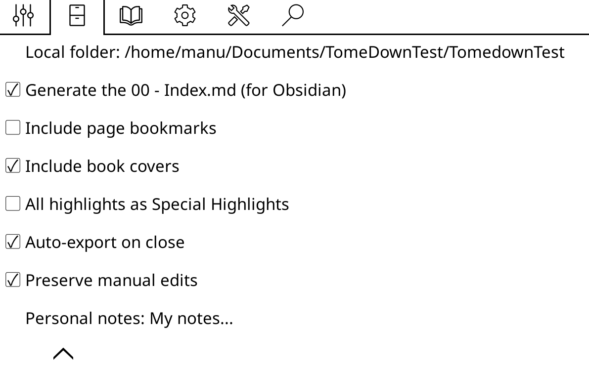

Ticking or unticking *Include book covers* rewrites every already
exported file on the next export (the stored hash is invalidated, so
*Export only what changed* re-sends everything once).

Covers are always exported in full colour, whatever the device: the
extraction forces colour rendering even on greyscale e-ink screens.

**Highlights**

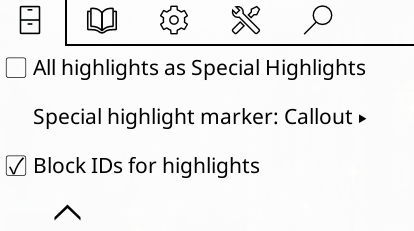

| Entry | What to do |
|---|---|
| *All highlights as Special Highlights* | off by default: every highlight becomes an `> [!highlight]` callout instead of a plain quote; when off, only *Special Highlight* marks (see *Usage*) turn into callouts |
| *Special highlight marker: %1* | only while the row above is off, since with every highlight a callout there is nothing left to choose (the row is grayed out): **Callout** is the default and keeps the box on the marked highlights alone, **Bold** writes them as `> **quote**` instead, for the readers that do not know callouts |
| *Block IDs for highlights* | off by default: writes a stable `^hl-xxxxxxxx` id at the end of every quote, so Obsidian can link to one single highlight and embed it (see *Block IDs and linking*) |

All three rows rewrite every already exported file on the next export:
none of them is part of the book's hash, so flipping one invalidates the
stored hashes, the way *Include book covers* does above.

**Updates**

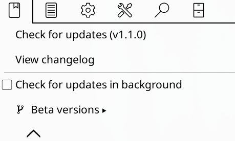

| Entry | What to do |
|---|---|
| *Check for updates (vX)* | the row doubles as the version display: it asks GitHub for newer stable releases, shows their notes and can install the update right away (**Update and restart**) |
| *View changelog* | pages through the notes of every release on GitHub, newest first; the list is cached when a check runs, so the viewer also works offline, and **Refresh** fetches it again |
| *Check for updates in background* | off by default: when enabled, a quiet check runs when KOReader starts and when the menu opens (at most once an hour) and notifies you of a new stable release |
| *Developer updates* | a submenu with everything that is not meant for daily use (below) |

**Developer updates**

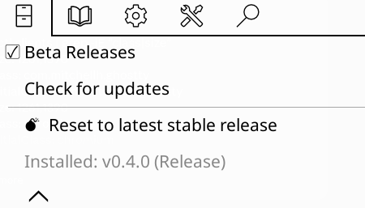

| Entry | What to do |
|---|---|
| *Beta Releases* | off by default: while ticked, the *Check for updates* row below appears and the changelog lists prereleases (tags like `0.4.0-beta.1`) too |
| *Check for updates* | only visible while *Beta Releases* is ticked: checks GitHub for newer prereleases right away and installs them the same way as a stable update |
| *Reset to latest stable release* | installs the newest stable release even when your install is a beta newer than it (the way back from a beta); it also unticks *Beta Releases* so the beta is not offered again |
| *Installed: vX (Release/Beta)* | the installed version as a plain label |

Everything is stored in KOReader's settings, so it applies to all books.

### If you already use AnnotationSync

The cloud server is **inherited automatically** from the one AnnotationSync
already saved in KOReader (`Cloud settings`): *Server and folder…* shows
exactly that. If it is the right folder, you do not have to touch anything.
On a fresh install *Upload to cloud* starts off. Tick it once you are
ready to send the `.md` files (installs that have already exported keep
it ticked).

If AnnotationSync uploads its `.json` files somewhere other than where you
want the `.md` files (say `/Bookshelf/Kindle`), set **Remote folder…** and
type the correct path: it applies to this plugin only.

Tip: keep the `.md` files in a folder where AnnotationSync's JSONs do not
land, or add `*.json` to Remotely Save's *Ignore list* so only the notes
reach Obsidian.

### Updates

*Check for updates (vX)* compares the installed version with the releases
on GitHub and shows the notes of **every** release newer than yours, so
someone updating from 0.2.0 to 1.0 reads the fixes of 0.3.0, 0.3.1 and
1.0 in one window. When your KOReader renders Markdown, the notes keep
their formatting (bold, headings, lists); older versions get them as
plain text. Tap **Update and restart**: the zip is downloaded, unpacked over the
plugin folder, and KOReader asks to restart. If the download or the
unpacking fails, the releases page opens instead so the zip can be taken
by hand (see *Installation*), which works from any older version.

Tick **Beta Releases** (*Settings → Developer updates*) to get the beta
channel: a second **Check for updates** appears below the box and offers
prereleases (tags like `0.4.0-beta.1`). The check in *Settings → Updates*
stays on stable releases whatever the toggle says, and unticking the box
hides the beta check again. A beta install always sees the final release
of the same version, so checking from `0.4.0-beta.1` offers `0.4.0`.

**Reset to latest stable release** is the way back from a beta: it installs
the newest stable release even when your beta is newer than it (the check
only ever offers *newer* versions) and unticks *Beta Releases* so the same
beta is not offered again.

When you publish a release, bump `version` in `_meta.lua` to the tag
without the `v`.

The updater is built to keep working from old installs: repository and
API URL never change, tags stay `vX.Y.Z` (prereleases `vX.Y.Z-beta.N`),
release zips keep the `tomedown.koplugin/` top-level folder, and
settings keys are never renamed.

## Usage

☰ menu → **Tomedown**:

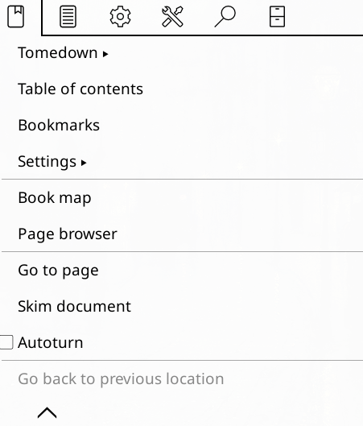

The menu itself, with a book open, where every row is on show:

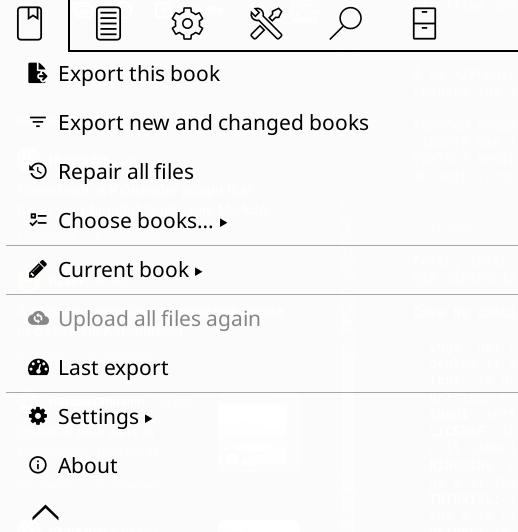

Three of these rows name a book, and they are only built while one is
open: *Export current book*, *Preserve: this book* and *Book notes: %1*.
From the file browser the menu starts at *Export only what changed*,
since there no book is open to speak about.

- **Export current book**: only the open book.
- **Export only what changed**: exports only the books whose highlights changed since
  the last export (per-book hash).
- **Preserve: this book**: the per-book switch of *Preserve: global*,
  shown only while the global one is off. It starts from the global default
  and stores the book's own choice. Turning it off asks first, then
  rewrites that file plain right away, keeping the one you had as `.bak`;
  turning it on again brings that copy back at the next export. Only that
  book's hash changes, so the rest of the library is left alone.
- **Book notes: %1**: the heading for this book alone, under the switch and
  only while the book keeps a zone to name. Tap it to give the book its own
  heading ("The Witch theory", "Julian Carax Dixit", …), or leave it empty
  to export that zone without one. Every other file, `00 - Index.md`
  included, keeps the global heading.
- **Choose books…**: a list with checkboxes: tick the volumes and export
  just those.
- **Export every book's highlights**: exports everything found in KOReader's
  reading history.
- **Upload everything to the cloud**: re-uploads every file already in the
  local folder (use it after a failed upload). Each markdown file is compared
  with its cloud copy first: notes written in Obsidian are folded in before
  the push, and a copy that cannot be read keeps its file out of the push
  and into the queue for the retry.
- **Status**: a wide popup (90% of the screen) in a small font: one line
  per entry, labels in bold, with network, server, pending uploads and
  the last export/upload with their timestamp and outcome.

  
- **Settings**: see above.
- **About**: a popup with the logo, the installed version, the description
  and the GitHub link (tap the link to open it or copy it).

On a fresh install, the first time you open the menu, Tomedown offers to
export the highlights of your whole KOReader reading history in one tap
(*Export* / *Not now*; the offer is made only once, and the menu entry
stays available anyway).

### Special highlights

Every book has a handful of highlights that really matter: the quote you
want to open first, the line you will come back to. **Special Highlight**
is the flag for those and only those. The mark lives inside the book's
own settings and is part of the book's hash, so the next export rewrites
that file; the flagged highlight always keeps a marker of its own: the
`> [!highlight]` callout by default, or `> **quote**` once you pick *Bold*
under *Settings → Highlights*. Either way it stays visually apart from
the plain quotes, even when *All highlights as Special Highlights* is
off. A notification confirms every change.

Marking it costs a single tap. **Selecting text** puts the row right
under *Highlight*: one tap creates the highlight and flags it.

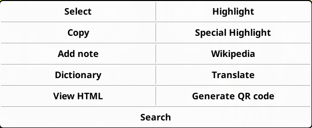

**Tapping an existing highlight** opens the compact edit menu (trash,
Style, Color, …), with the same row at the bottom. The label says what the
tap will do: *Special Highlight* flags it, *Remove Special Highlight*
takes the flag off, and a notification confirms either way.

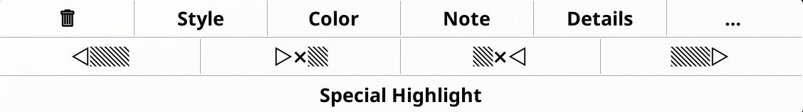
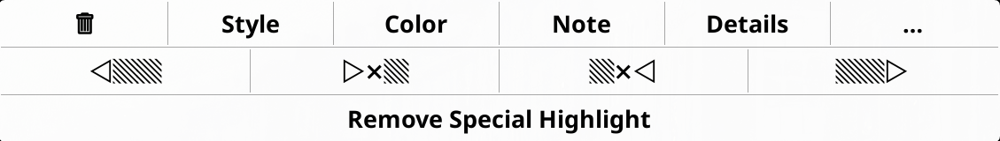

The full menu behind the "…" button carries the same row, so a flagged
highlight always offers its own undo and a missed one can still be
flagged.

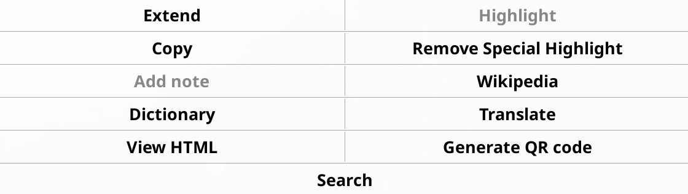

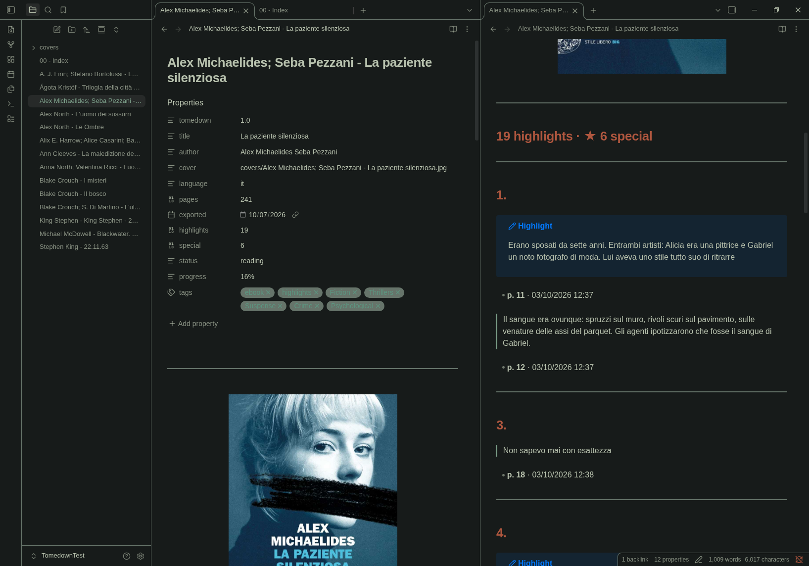

Callouts are an Obsidian convention. In **Notion** (and in GitHub, which
only knows its own few alerts) the marker imports as the literal text
`[!highlight]` inside the quote: quote, page and note all arrive, only the
coloured box is missing. The word in brackets is the flag itself, there to
be deleted or ignored.

After every export, if *Upload to cloud* is on, the `.md` files and the
index go to the chosen server automatically. With *Include book covers*
ticked the `covers/` folder travels with them (it is created on the first
upload) and each cover leaves the device after its upload succeeded; with
the option off, no image folder is created at all.

### Block IDs and linking

*Block IDs for highlights* (Settings → Highlights) writes a short id at
the end of every quote:

```md
> First highlighted sentence. ^hl-4f2a9c31
```

The id belongs to the highlight, not to the export, so it never moves:
the same quote keeps the same `^hl-` on every re-export, and a link
written today still lands on it tomorrow. Obsidian can then point at one
single quote of the whole library:

- `[[Book title#^hl-4f2a9c31]]` opens that book's note at the quote;
- `![[Book title#^hl-4f2a9c31]]` pulls the quote into the page you are
  writing, wherever that page sits in the vault.

Inside an `> [!highlight]` callout the anchor stays out of sight while
you read, tucked away by the box: click the quote to edit it and
`^hl-4f2a9c31` is there at the end of the line. Reading or editing, the
links find it the same.

Off by default: the apps that do not know ids show `^hl-4f2a9c31` as
plain text at the end of the quote, the same way Notion shows
`[!highlight]`, so leave the toggle off if you read the notes anywhere
but Obsidian.

### Auto-export and offline reading

With *Auto-export on close* enabled, closing a book exports it on the spot;
suspending the device does the same right before sleep, silently, without
any widget and without touching the network.

No connection? The export still happens locally and the files wait in a
pending list. As soon as KOReader comes back online (the connection event
is enough: no prompt, no dialog), **only those pending files** are
uploaded: books already in the cloud and unchanged are never re-sent, and
a book whose highlights changed since its last upload is uploaded again,
overwriting the old copy. Failed uploads stay pending and are retried on
the next connection.

### Upload retries

While uploading, an *Uploading N files to the cloud…* message stays on screen
(including the wait times), and each file is tried **up to 3 times** with
exponential backoff:

| attempt | wait before the next one |
|:--:|:--:|
| 1 | 2 seconds |
| 2 | 4 seconds |
| 3 | done: the file is marked as failed |

Only **transient** failures are retried:

- network errors (no HTTP code, e.g. `connection reset`, timeout);
- `5xx` (server temporarily unavailable);
- `408` (request timeout) and `429` (too many requests).

`4xx` errors (missing remote folder, wrong credentials…) are **not** retried:
the file fails immediately, because retrying would only cost waiting.

If a file still fails after the 3 attempts, a window shows
`Cloud: X uploaded, Y errors` and everything else continues: the files stay in
the local folder, so you can fix the problem and use **Upload everything to
the cloud**. The attempts are also logged:

```
tomedown: upload failed (attempt 1 of 3), retrying in 2 s: <path> 500
```

### Preserve your edits

Your vault is the destination, not a cache. Since 1.0 an export can fold
the new render into the file already in your vault instead of overwriting
it. **Preserve: global** is off by default (what every release up to 0.8
always did), so upgrading changes nothing: turn it on in *Settings →
Markdown files* and the file becomes a shared document.

While it is on there is nothing else to decide: it alone is in charge of
every file, every file keeps its zone, and *Notes: %1* names all of them.
The rows that choose for one single file are not shown, and the choices
behind them stay stored, waiting for the switch to go off again.

Since 1.1 the choice is also **per book**, with the global switch off.
*Preserve: this book*, in the open book's menu, keeps the zone for that
book alone, and the choice survives later flips of the global switch.
Tapping it again asks first, saying the file goes back to a plain export;
confirming stores an explicit off and writes that file plain there and
then, with the one you had kept whole as `.bak` first. That copy comes back
into the file the next time you turn preserve on, which is what makes the
box's promise true. While a book keeps a zone its menu grows a second row,
*Book notes: %1*, which names that book's zone and no other file's. The
rows of *Settings → Markdown files* keep speaking about the global switch
only: *Notes: %1* appears while it is ticked, whatever the books chose,
because a book's own choice lives in the book's own menu.

`00 - Index.md` follows the same shape. With the global switch off, its
own switch, *Preserve: index*, sits in *Settings → Markdown files* under
the global one, with *Index notes: %1* under it to name the zone. The index
starts out the way the global switch is set, and no book turns it on behind
your back any more, so exporting a book never takes the notes you wrote in
the index away by surprise. Turn its switch off and the index exports plain
from the next export on, with the one you had kept whole as
`00 - Index.md.bak` first; turn it on again and that copy comes back. With
the global switch on, both of its rows are hidden.

Every file holds one generated block. With the toggle on, the block is
wrapped in two invisible HTML comments Tomedown uses as handles, under
the heading the plugin owns and with its tag. The plain export writes none
of that: no comments, no tag, no heading, nothing to merge when every run
overwrites.

```markdown
---
title: "Blackwater"
…
---

## My notes... <!-- tomedown:notes -->

your own intro, links, thoughts: everything under the heading
and outside the block is yours

<!-- tomedown:begin body hash=54dc6b6b — ⛔ generated below: do not edit inside or updates stop arriving · write your notes above -->

---

# **150 highlights · ★ 42 special**

# Chapter I

> First highlighted sentence.

- **p. 10** · 02/09/2026
<!-- tomedown:end body -->
```

Obsidian and every Markdown renderer ignore the comments, so the file
looks exactly the same. The begin comment carries the digest (`hash=…`)
of the block it wraps, the proof Tomedown compares against to tell a
touched block from one of its own at a glance. On every export:

- text you wrote **outside** the block (under the heading, below the end
  comment, your own frontmatter properties) is carried over untouched,
  wherever it sits;
- the block itself is always regenerated: new highlights, page bookmarks,
  the highlight recap heading, the index;
- a block you edited **inside** the comments is not a lost cause. The
  previous file is kept as `<name>.md.bak.1` before the rewrite, so your
  line waits in the safety copy while the fresh block joins in (the toast
  reports `N files backed up (.bak)`). A file that has to be rebuilt from
  scratch (markers broken beyond repair, an export from tomedown ≤ 0.8)
  comes with the same copy;
- **the `.bak` is your file, parked.** When preserve goes off, the zoned
  file, notes included, is kept as `<name>.md.bak` while the plain export
  takes its place. There is one `.bak` and it is always the latest:
  turning preserve on again makes it the base of the next export, so your
  notes are back. On, off, on, off, on: every note you kept is back each
  time, and one you deleted stays deleted. A `.bak` is never copied twice
  and never grows a twin beside it;
- `<name>.md.bak.1` is the safety copy, only for text that cannot come back
  by itself: something typed into the plain file while preserve was off
  (that file is regenerated, so the text cannot join the zone), a block
  edited inside its comments, a cloud copy that moved on. It has one slot
  and never takes the place of the `.bak`;
- a file Tomedown itself wrote is never copied. When an export finds the
  very bytes the last run left there, nothing of yours sits in them, so no
  safety copy is taken (the first run after an upgrade has not seen your
  file yet and keeps one copy, just in case);
- if a copy cannot be written (a full card, a read-only folder) the file
  is **left as it is** and the export reports the error: a note is never
  traded for a rewrite. The next export tries again;
- with two readers on one cloud folder: while preserve is off the export
  does not read the cloud copy, so a plain file edited on another device
  is replaced by the upload, as it always was. Turn preserve on and the
  cloud copy is read: if it is a plain file edited elsewhere, its text is
  kept as `.bak.1` and the `.bak` of this device is the one that comes
  back, because the file on the device is the one that counts. A cloud
  copy that has a zone is merged as usual;
- the frontmatter merges field by field: Tomedown's own fields (`status`,
  `progress`, `exported`…) always show KOReader's values, your tags are
  kept and unioned with the new ones, and a property only you added
  (`rating: 5`, an alias…) survives, even a line the parser cannot place
  is kept verbatim at the end;
- the heading is the plugin's line (with preserve on, the
  `<!-- tomedown:notes -->` tag gives it away). Renamed from *Notes: %1*
  (*Settings → Markdown files*), it is rewritten on the next export while
  your text below it stays put. Leave the setting empty and files export
  without a heading; with preserve off they export without one at all (the
  next run would take it, and anything written under it, away);
- the zone around it breathes: **two blank lines** under the heading and
  two above the marker, so there is room to start writing. Nothing else is
  put in your way (the invitation older builds seeded an empty zone with is
  dropped at the next merge). The [Obsidian guide](OBSIDIAN.md) walks
  through the file as it sits in the vault, with and without the toggle.

The global switch in *Settings → Markdown files* controls all this:

- **Preserve: global**: off by default. Every export writes exactly what
  was generated, a plain Markdown file with no markers, no tag and no
  heading, replaced wholesale on the next run. Switch it on and every
  export folds the new render into your file; switching modes rewrites
  every file on the next export (the plain file as it was comes along as
  `.bak` when the handles appear).

The result toast and the *Status* panel report the backups of the last
run: `%1 files backed up (.bak)`.

Good to know:

- don't move or delete the `<!-- tomedown:begin … -->` comments (they only
  exist with preserve on). A marker line you broke is repaired around your
  zone on the next export; a deleted one still recovers the zone (with a
  `.bak` alongside); a file with no markers at all is **adopted**: its text
  becomes the zone above the block and the block joins in, nothing is lost
  (an export from tomedown ≤ 0.8 is rebuilt once the same way, then
  behaves like every other file);
- files in the old three-region layout (preamble, highlights, bookmarks)
  are migrated once: your zones move above and below the new single
  block, the old generated content is dropped (the render has it again),
  and a region you had edited survives only in the `.bak` written
  alongside;
- markers from older builds carry no hash: for them the fingerprint from
  the last export decides whether the block counts as edited (with none
  to compare, the block counts as ours);
- with preserve off the file is regenerated at every export. Text typed
  into it can only be kept when preserve comes back on, and lands in
  `.bak.1`; an export while preserve is still off overwrites it.

### Editing in Obsidian while the device is away

If you export to the cloud and keep the vault in sync (WebDAV, Dropbox,
FTP, Nextcloud or Remotely Save), you can write in Obsidian on the desktop
and keep reading on the device. The two sides write the same file, so the
export has to know which copy is newer. Otherwise every export would fold
the new highlights into the older copy on the device and push it over the
notes you just wrote.

With **Merge edits made in the cloud** on (the default, it lives in
*Settings → Cloud* right under *Upload to cloud*), an export fetches the
copy in the cloud before folding the render in, and uses it as the base
when it has changed since the last upload Tomedown made. The notes you
wrote in Obsidian survive, the fresh highlights join them, and the file
goes back to the cloud with the device up to date. The fetch only happens
for the files being exported, and only while there is a connection.

A few things worth knowing:

- with *Preserve: global* off (the default) every export overwrites the
  file, so the toggle has nothing to merge and does nothing. Turn preserve
  on to let your notes ride along;
- the first export into a folder that already has files adopts the cloud
  copy as the base, so an existing vault is not overwritten on the first
  run;
- turn the toggle off if you would rather have the device always win (for
  example when the cloud folder is a backup and never edited elsewhere);
- **the offline window is safe too**. An export made with no connection
  writes the highlights into the file on the device and queues it. When the
  connection comes back, before that file is pushed, Tomedown fetches the
  cloud copy and compares it with the one it last sent. If you wrote in
  Obsidian in the meantime, that copy is folded into the file first, so the
  notes ride along with the new highlights instead of being overwritten. If
  a transient error stops the fetch, the file is held back and retried at
  the next chance rather than pushed blind: nothing is lost in either
  direction;
- the same guard runs while you are online. An export or an upload whose
  cloud copy cannot be read keeps that file out of the push and queues it
  for the retry, and *Upload everything to the cloud* runs the same
  comparison before pushing. A server that cannot download has nothing to
  compare against and receives the local copy as it is; with *Merge edits
  made in the cloud* off, the copy on the device always wins.

## File format

The file as it comes out with **Preserve: global** on. The plain
export (the default) is the same document with the two comments, the
heading and its tag left out:

```markdown
---
title: "Blackwater"
author: "Michael McDowell"
series: "Blackwater"
series_index: 1
language: "it"
pages: 1140
exported: 2026-09-26
highlights: 150
special: 42
status: "complete"
progress: "96%"
tags:
  - ebook
  - highlights
  - horror
  - gothic-fiction
---
## My notes... <!-- tomedown:notes -->

<!-- tomedown:begin body hash=9e7017ad — ⛔ generated below: do not edit inside or updates stop arriving · write your notes above -->

---

# **150 highlights · ★ 42 special**

---

# Chapter I

> First highlighted sentence.
> Second line of the same highlight.

- **p. 10** · 02/09/2026 10:00
  - **NOTE:** *to reread*

> Another highlight.

- **p. 12** · 03/09/2026 11:30

---

# Page bookmarks

> Check the epilogue again

- **p. 120** · 04/09/2026 08:15

<!-- tomedown:end body -->
```

- the frontmatter keeps what KOReader knows about the book: `series` and
  `series_index` (only when the book belongs to a series), `language`,
  `pages`, the reading `status` (`reading` / `abandoned` / `complete`),
  `progress`, and the book's keywords appended to `tags`. Every keyword is
  normalised into a valid Obsidian tag: spaces become `-`, and only
  letters, numbers, `-`, `_`, `/` and non-ASCII characters (accents, emoji)
  survive, everything else (`;`, `'`, `=`, `[`, `]`…) is dropped. A field
  KOReader does not know (ISBN, for instance) is simply not there;
- **only highlights** are exported by default: page bookmarks and deleted
  annotations are left out. Tick *Include page bookmarks* in Settings to
  get the `# Page bookmarks` section shown above.
- with *Include book covers* ticked the file also carries `cover:
  "covers/Author - Title.jpg"` in the frontmatter and a centered ``
  (wrapped in `<p align="center">`) right after the opening rule, with a
  second rule between the cover and the `# **150 highlights**` recap heading. The cover is the
  embedded one (or the custom cover KOReader knows), resized into a
  800×1200 JPEG and dropped from the device after a successful upload;
  the copy in the vault is the master one. Obsidian renders such images
  starting with **version 1.8.1**
- highlights marked **Special Highlight** (see *Usage*) are rendered as
  `> [!highlight]` callouts; with *All highlights as Special Highlights* ticked
  every highlight gets the marker, otherwise only the special ones:

  ```markdown
  > [!highlight]
  > First highlighted sentence.
  > Second line of the same highlight.

  - **p. 10** · 02/09/2026 10:00
    - **NOTE:** *to reread*
  ```
- the file name matches KOReader's standard exporter (`Author - Title`), so
  it does not clash with exports you already made
- the page is the stable page number (`pageref`) when available, otherwise
  the running page number; the date under each highlight includes the
  time (`HH:MM`)
- files exported by an older version of tomedown keep their old look
  until they are rebuilt: the render format is part of the stored hash,
  so the first export after an update rewrites every file in the current
  format
- the index uses wiki links (`[[…]]`), opened natively by Obsidian and by
  most Markdown apps; the body opens with a rule and a stats line (books,
  highlights, starred specials) above the table, and with covers enabled the
  first column shows the cover image (120×160 box):

  ```markdown
  |  | [[Michael McDowell - Blackwater\|Blackwater]] | Michael McDowell | Blackwater #1 | Complete<br>▰▰▰▰▰▰▰▰▰▰&nbsp;96% | 26/09/2026 | 150 · ★42 |
  ```

  Without the option the cover column disappears. The Status cell holds
  whatever the book has: the status word on the first line, the progress
  bar under it with the percentage glued to the bar by a no-break space,
  so Obsidian can never drop a two-digit `96%` onto a line of its own, and
  a dash when it has none. The last read date has a column of its own, the
  same goes for a missing series, and a book with starred highlights shows
  them as `· ★42` next to the count.

The sample above is what an English KOReader produces; with an Italian
interface the same text comes out translated (see *Languages*).

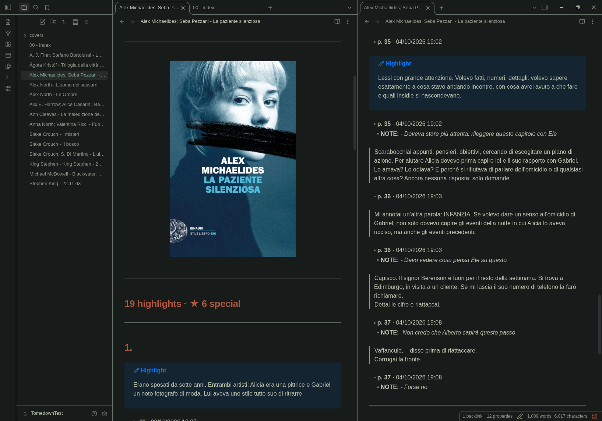

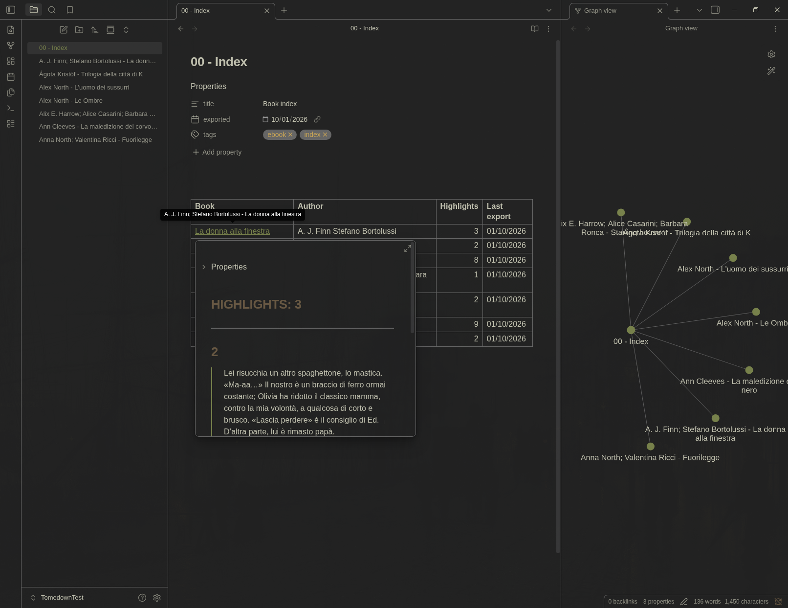

## Obsidian (optional)

Obsidian is just one way to read the notes: the files are plain Markdown,
so any editor, reader or wiki works. The [Obsidian guide](OBSIDIAN.md)
walks through the files as they appear in the vault: the book note with
and without Preserve, and the index. If you do use Obsidian, only
**Remotely Save** needs configuring here: the Tomedown plugin lives on
KOReader, nothing special has to be installed in Obsidian. **Book covers
(*Include book covers*) require Obsidian 1.8.1 or newer**: that is the
version that started rendering `` tags whose `src` points at a file
inside the vault; older versions show a broken image. The steps below
use Koofr (this README's example cloud); with any other WebDAV server
(Nextcloud, ownCloud, a NAS…), substitute its address and credentials.

1. On Koofr create an app (Security → Applications) and copy the **app
   password**, not the account one.
2. In Obsidian install **Remotely Save** and configure:
   - type: **WebDAV**
   - server: `https://app.koofr.net/dav/Koofr`
   - user: your Koofr account e-mail
   - password: the app password
   - **remote folder / base dir: `/Bookshelf`**
   - **Abort Sync If Modification Above Percentage: `100 (disable the
     protection)`**: Tomedown re-exports notes in bulk (first export,
     toggling *Include book covers*, migrations), which trips the default
     `50` guard and aborts the sync with *"you set changing files >= 50%
     is not allowed"*; the vault is regenerated from KOReader at any time,
     so disabling that protection is safe
3. In Remotely Save's local data, point to the folder that holds your books
   vault (in this example `Bookshelf/`).
4. Sync.

One setting deserves a page of its own: Remotely Save's experimental
**Sync Direction**. Leave it on **Bidirectional (default)**:
[SYNC-DIRECTION.md](SYNC-DIRECTION.md) explains the five options and
where your edits live.

Result: `Bookshelf/Kindle/*.md` arrive in Obsidian, `00 - Index.md` opens as
a clickable table and every title opens that book's file.

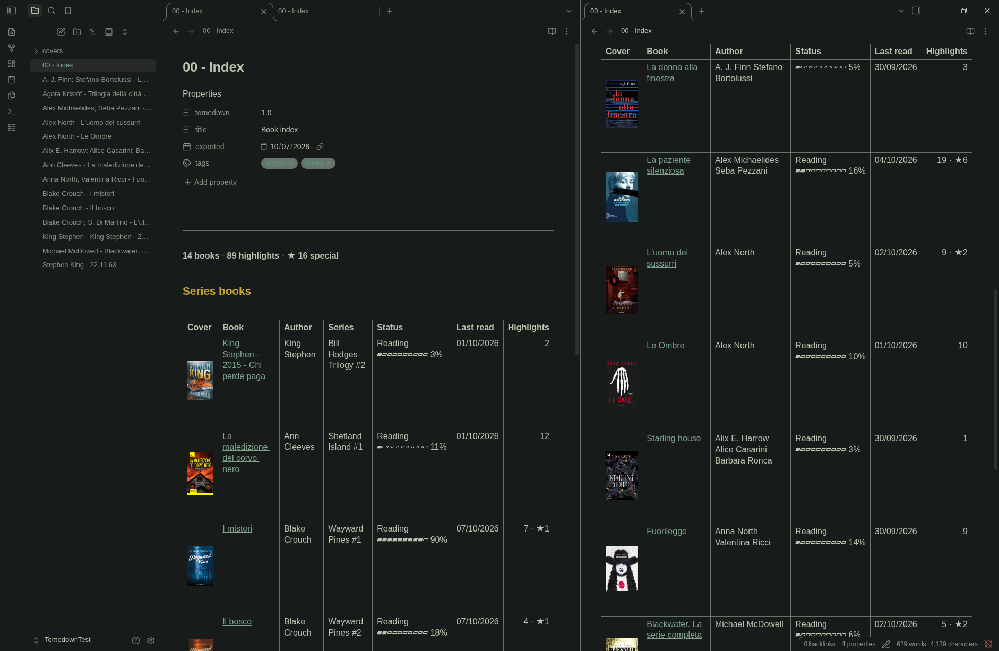

## Notes and limitations

- With preserve off, the `.md` files are **rewritten on every export**:
  treat them as read-only, or your edits disappear next time. With preserve
  on, write outside the block and your notes survive.
- I test on a Kindle Paperwhite 5 and on a Kindle 4 Non-Touch. The plugin
  is plain Lua and touches no hardware, but I cannot try every KOReader
  build or every cloud server. If something breaks on yours, a report with
  the KOReader version and the `tomedown:` log line helps me more than a
  description.
- The plugin **never touches** AnnotationSync's files (`<md5>.json`,
  `settings_sync.json`): it only reads the `.sdr` folders.
- Uploads go through KOReader's *Cloud storage* plugin. If it is not active
  the local export still works and only the upload is skipped. If an upload
  fails (missing remote folder, no connection), the files stay in the local
  folder: fix it and use **Upload everything to the cloud**.

## Languages (English / Italian)

Plugin strings are **English** in the code (`_("…")`), as KOReader
conventions require, and are shown **in Italian** when KOReader's interface
is Italian: no setting to change, only KOReader's language matters.

How it works: KOReader only translates its core (`l10n/<lang>/koreader.mo`)
and does **not** load plugin `.po` files automatically, so
`tomedown_i18n.lua` reads `languages/it.po` based on the current language
(`GetText.current_lang`, falling back to *Settings → Language*) and swaps the
texts. On English (or when no translation exists) the original msgid is
used.

The text inside the `.md` files is translated too (titles,
`No chapter`, `N highlights`, `Page bookmarks`, `Book index`, table
headers), so your exported notes follow KOReader's language.

To fix or add a translation: edit `languages/it.po` (msgid = English source,
msgstr = Italian) and restart KOReader. It is standard gettext: for another
language just copy it to `languages/<code>.po`.

## Debug

In case of trouble:

```
/mnt/us/koreader/crash.log
```

Plugin messages are prefixed with `tomedown:`.

## Tests

The suite lives in `tests/` and needs Lua 5.3 or newer (the test md5 uses
bitwise operators):

```
cd tests && ./run.sh
```

It covers the Markdown render, the `languages/it.po` sync, the runtime
translations and `main.lua` (export, menu, dialogs, fallback servers,
uploads and retries) against a fake KOReader environment (`kostubs/`). It
ends with `luac5.1 -p` on the sources, the same Lua version that runs on
the Kindle. The same suite runs on every push through GitHub Actions.

## Project structure

```
tomedown.koplugin/
├── _meta.lua              plugin name and description
├── main.lua               menu, .sdr reading, export, upload (with retries)
├── tomedown_render.lua    Markdown builder (pure, testable)
├── tomedown_i18n.lua      reads languages/<lang>.po (English/Italian)
├── languages/
│   └── it.po              Italian translation (read by tomedown_i18n)
├── tests/                 test suite + fake KOReader environment
│   ├── run.sh             runs everything, ends with luac5.1 -p
│   ├── kostubs/           stubs for KOReader's Lua modules
│   └── test_*.lua
└── README.md
```

## Support

If it saves you time, you can buy me a coffee: the next features are
brewed with it.

<p align="center">
  <a href="https://ko-fi.com/imanubdesigner">
    
  </a>
</p>

## License

GNU Affero General Public License v3.0, see [LICENSE](LICENSE).
