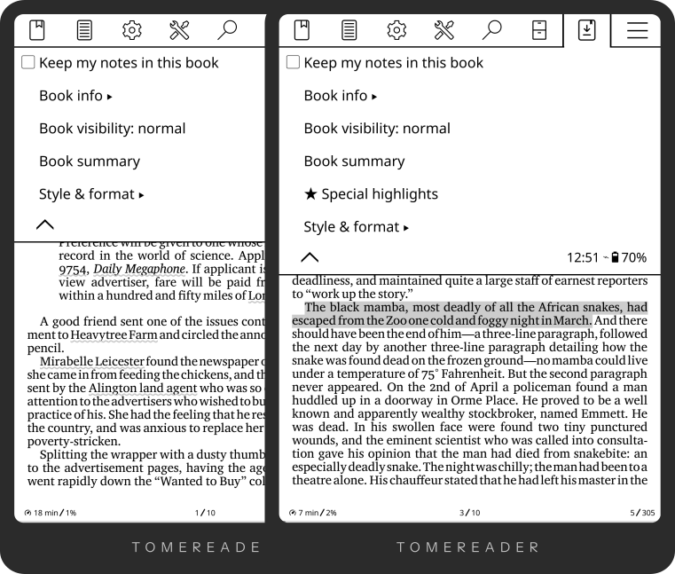
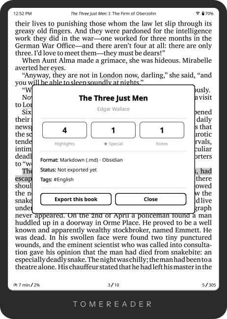
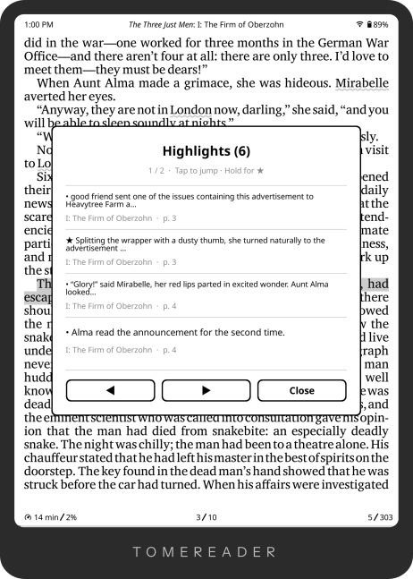
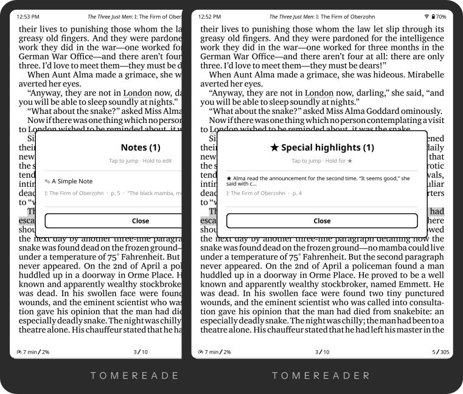
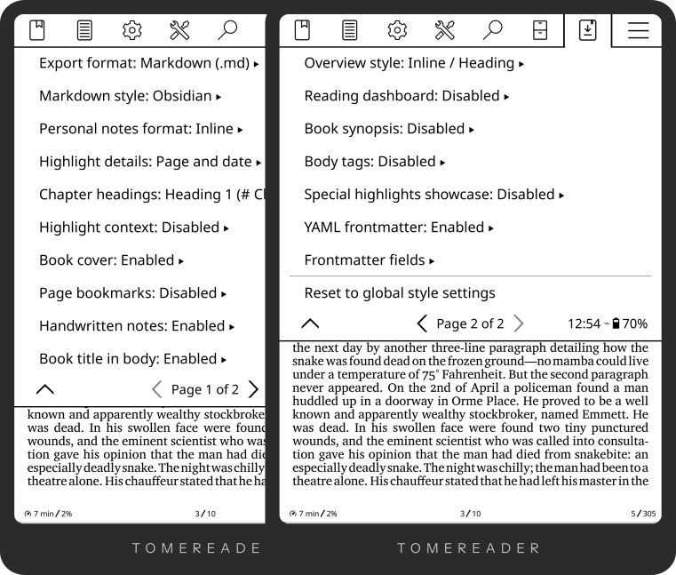
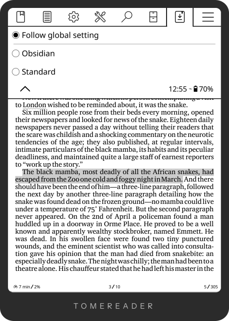
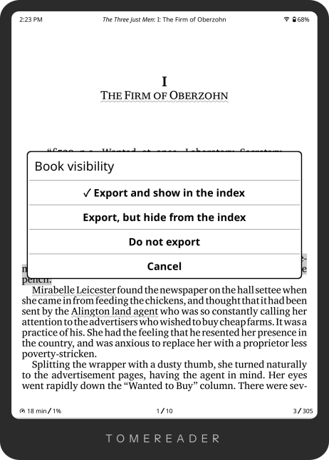

# Current book

In-reader controls, dashboard cards, highlight navigation, per-book format overrides, and metadata management in KOReader.

[Back to the README](../README.md).

☰ menu → **Tomedown** → **Current book**, available whenever a book is open:

While [Menu & Settings](settings.md) configures global defaults applied across your entire library, **Current book** controls the volume currently open on your screen. Here you can inspect your reading session, jump across quotes, override export formats, manage book info, and edit notes directly inside KOReader.

## Current book menu reference

| Entry | What it does |
|---|---|
| *Keep my notes in this book* | Enables [Keep my notes](keep-my-notes.md) specifically for this volume without turning it on for all books. If turned off later, Tomedown asks first and preserves an automatic `.bak` copy before reverting to plain exports |
| *Book info* | Opens the book info submenu to import KOReader ratings, reviews, reading dates, collections, or manage per-book tags (see [Book info](#book-info--metadata)) |
| *Book visibility: %1* | Toggles between **Normal** (the book is exported and listed in `00 - Index.md`) and **Do not export** (the book is skipped during library exports and omitted from the index) |
| *Notes heading: %1* | Displayed when *Keep my notes* is active for this book: tap to set a custom Markdown heading (e.g. `## My thoughts`) above the generated body |
| *Backup copies (%1)* | Displayed when `.bak` snapshots exist for this book: opens a submenu to view real file dates and safely delete stale backup files |
| *Book summary* | Opens the rounded e-ink dashboard card showing book metrics, 3 KPI counters, format, and sync status (see [Book summary](#book-summary-dashboard-card)) |
| *★ Special highlights (%1)* | Displayed when starred highlights exist in the book: opens the in-device card browser to review standout passages |
| *Style & format* | Overrides global style settings (Markdown style, export format, headings, context, covers) specifically for this book (see [Style & format overrides](#style--format-overrides)) |

## Book summary dashboard card

Under **Tomedown → Current book → Book summary**, Tomedown opens a rounded dashboard card built specifically for e-ink displays:

### What the card displays

- **Book Title & Author**: Extracted cleanly from the document metadata.
- **3-Column KPI Buttons**:
  - **Highlights**: Total count of all highlighted passages in the book.
  - **★ Special**: Count of standout passages marked with *Special highlight*.
  - **Notes**: Count of highlights that have personal user notes attached.
- **Format**: Shows the effective export format and Markdown style for this book (e.g. `Markdown (.md) · Obsidian` or `Markdown (.md) · Standard`).
- **Status**: Indicates the export state:
  - `Up to date`: Exported file matches your latest highlights and reading position.
  - `Updates pending`: New highlights, notes, or reading progress await the next export.
  - `Not exported yet`: Book has not been exported to disk yet.
- **Action Buttons**:
  - **Export this book**: Immediately exports the open book, extracts covers or drawings if enabled, and uploads the note if cloud sync is configured.
  - **Close**: Closes the card and returns smoothly to your reading session with full screen repaint.

## Highlights, ★ Special & Notes card browser

Tapping any of the three KPI buttons in **Book summary** (or selecting **Current book → ★ Special highlights**) opens the paginated card browser for your annotations:

- **Highlights KPI**: Browses all extracted quotes and passages from the book.
- **Notes KPI**: Displays only passages that contain personal annotations.
- **★ Special KPI**: Displays all passages you have marked as favorites.

The card browser allows you to review and manage your annotations without leaving your reading session. Designed for 6-inch e-ink screens, it features pagination controls (`◀` / `▶`) showing 3 to 4 items per page.

### Gestures & Shortcuts

| Action | Highlight / ★ Special cards | Notes card |
|---|---|---|
| **Short tap** | **Jump to passage**: Instantly navigates to the highlighted location in the book (`GotoXPointer` on reflowable EPUBs, `GotoPage` on PDFs) | **Jump to passage**: Navigates directly to the page and sentence where the note was recorded |
| **Long-press** | **Toggle ★ Special**: Star or unstar the passage in place without leaving the card. The change is persisted immediately to KOReader's `.sdr` file | **Edit note**: Opens KOReader's `InputDialog` showing your existing note. You can edit the text, append thoughts, or clear it completely |

## Style & format overrides

By default, every book follows your library-wide defaults configured in [Settings → Style](settings.md#style) and [Settings → Files](settings.md#files). Under **Current book → Style & format**, you can customize settings for a single volume without affecting the rest of your library:

### Available overrides

1. **Export format**: Choose between **Follow global setting**, **Markdown (.md)**, **Plain text (.txt)**, or **Both (.md and .txt)**.
2. **Markdown style**: Select **Follow global setting**, **Obsidian** (wikilinks, `[!...]` callouts, `^hl-` block IDs), or **Standard** (universal markdown headings, `[Title](file.md)` links, no orphan block IDs).
3. **Personal notes format**: Override between **Inline** (indented right under the quote) or **Footnotes** (`[^1]` at the end of the file).
4. **Highlight details**: Switch between **Page and date**, **Page only**, **Date only**, or **None**.
5. **Chapter headings**: Override heading level (**Heading 1**, **Heading 2**, **Heading 3**, or **None**).
6. **Highlight context**: Enable or disable sentence surrounding extraction for this book.
7. **Book cover**: Override cover image extraction for this volume.
8. **Page bookmarks & Handwritten notes**: Enable or disable bookmarks and stylus vector drawing extraction.
9. **YAML frontmatter**: Enable or disable frontmatter generation for this title.
10. **Reset to global style settings**: Removes all per-book overrides and restores global defaults with a single tap.

### Selecting Markdown style for a book

When you select **Standard** for a book, Tomedown automatically adapts the generated note:
- Callouts (`[!book]`, `[!abstract]-`, `[!highlight]`) become clean Markdown headings (`### Reading dashboard`, `### Book synopsis`, `### ★ Special highlights`).
- Obsidian wikilinks switch to standard `[Title](file.md)`.
- Obsidian-only block IDs (`^hl-xxxxxxxx`) are omitted.
- Obsidian-specific style options (such as *Treat every highlight as special*) are disabled for that volume.

## Book info & Metadata

Under **Current book → Book info**, you can enrich your book note with extended metadata tracked by KOReader:

- **Import book info**: Reads the volume's rating (1–5 stars), personal review text, reading dates (`date_started`, `date_finished`), reading status (`reading`, `complete`, `abandoned`), and KOReader collections into the note's YAML frontmatter.
- **Tags: %1**: Assign custom tags to this specific book. Assigned tags appear under the title in `00 - Index.md`, in frontmatter, and inside the book note.
- **Delete tags…**: Delete obsolete tags across your library and clean up the suggestion cache.

To automate metadata imports across all your books, see [Settings → Book info → Update book info automatically](settings.md#book-info).

## Book visibility & Keep my notes

### Hiding books from export

Setting **Current book → Book visibility** to **Do not export** instructs Tomedown to ignore this volume during library-wide exports. The book will not generate a `.md` file and will be excluded from `00 - Index.md` and `00 - Reading Digest.md`.

### Per-book Keep my notes

If you want to write personal summaries or commentary directly inside certain Markdown notes while keeping plain, automated exports for others:

1. Open the book in KOReader.
2. Tap **Tomedown → Current book → Keep my notes in this book**.
3. Tomedown writes a protected `## My notes... <!-- tomedown:notes -->` zone at the top of the file.
4. Any thoughts you type above the body zone in Obsidian or your text editor will remain intact on every future export from KOReader.

If you ever disable *Keep my notes* for the book, Tomedown creates an automatic `.bak` copy of your note before switching back to plain exports, ensuring your manual thoughts are never lost.
