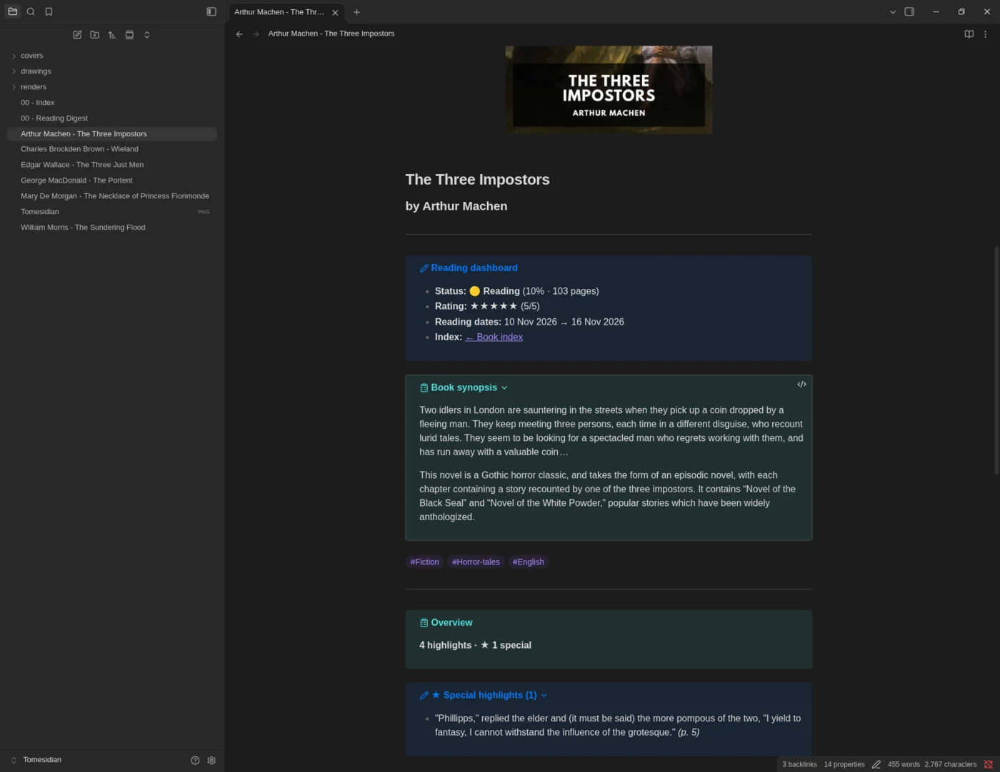
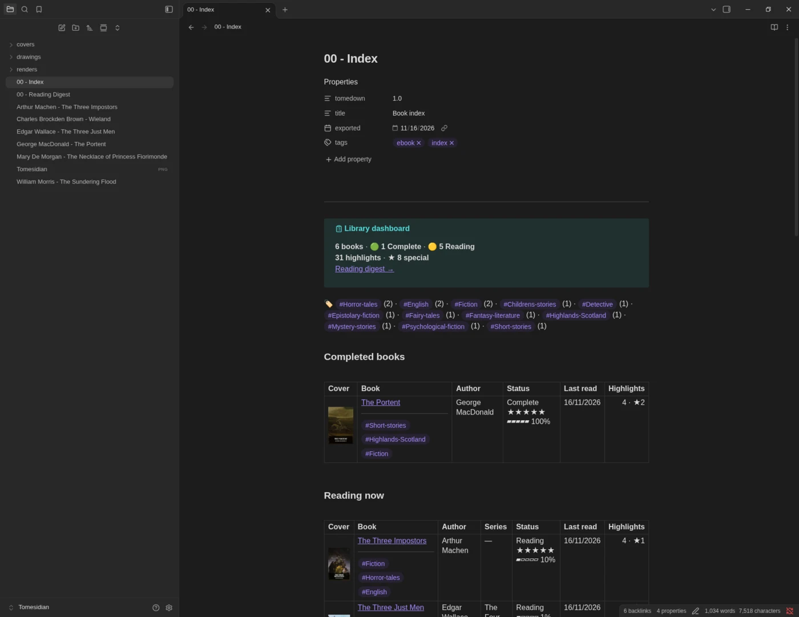

# File format & specifications

Technical specifications of the Markdown documents, frontmatter schema, and tables generated by Tomedown.

The sample below shows a book note exported with **Keep my notes for all books** enabled. In a plain export (the default), the document is identical except that the `## My notes...` heading and the HTML hash comments are omitted.

```markdown
---
tomedown: "1.0"
title: "The Three Impostors"
author: "Arthur Machen"
language: "en"
pages: 210
exported: 2026-11-16
highlights: 14
special: 2
status: "reading"
progress: "38%"
tags:
  - ebook
  - highlights
  - horror
  - weird-fiction
---
## My notes... <!-- tomedown:notes -->

<!-- tomedown:begin body hash=9e7017ad — ⛔ generated below: do not edit inside or updates stop arriving · write your notes above -->

# The Three Impostors
### by Arthur Machen

> [!book]
> - **Status:** Reading (38%)
> - **Rating:** ★★★★☆ (4/5)
> - **Reading dates:** 10 Nov 2026 → 16 Nov 2026
> - **Index:** [[00 - Index|← Book index]]

> [!abstract]- Synopsis
> A gripping mystery following Mr. Dyson and Mr. Phillips through the gaslit streets of London...

#horror #weird-fiction

---

> [!summary] Overview
> **14 highlights · ★ 2 special**

---

> [!highlight]- ★ Special highlights (2)
> > “It is an old story; but it is ever new to those who have the eyes to see and the heart to feel.”
> > — *Chapter I* · p. 15
>
> > “I yield to fantasy, I cannot withstand the influence of the grotesque.”
> > — *Prologue* · p. 5

---

# Chapter I

> It is an old story; but it is ever new to those who have the eyes to see and the heart to feel.

- **p. 15** · 16 Nov 2026 | 10:20
  - **NOTE:** *to reread*

> Another highlight.

- **p. 18** · 16 Nov 2026 | 11:30

 ^hl-3a8f19bc

- **p. 25** · 16 Nov 2026 | 12:05 · ✍️ Handwritten note
  - **NOTE:** *Margin sketch and arrow*

---

# Page bookmarks

> Check the epilogue again

- **p. 120** · 04 Sep 2026 | 08:15

<!-- tomedown:end body -->
```

<figure class="doc-shot">
  <div class="doc-shot-frame">
    
  </div>
  <figcaption>Book note header modules in Obsidian: Reading dashboard, collapsible synopsis, tags, Overview, and Special highlights showcase.</figcaption>
</figure>

The sample above reflects an English interface. When running KOReader in Italian, German, French, Spanish, or Brazilian Portuguese, all exported headings and status labels are translated automatically (see [Languages](developing.md#languages)).

## Frontmatter schema

| Field | Description & origin |
|---|---|
| `title`, `author` | Metadata extracted from the book file by KOReader |
| `series`, `series_index` | Present only when the book belongs to a series |
| `language` | Two-letter or full language code |
| `pages` | Total page count |
| `exported` | Date of the latest export (`YYYY-MM-DD`) |
| `highlights`, `special` | Total highlights count and count of starred highlights |
| `status` | Reading status: `reading`, `abandoned`, or `complete` |
| `progress` | Reading position percentage, for example `"96%"` |
| `published`, `rating`, `review`, `date_started`, `date_finished`, `collections` | Extended KOReader metadata, populated when *Import book info* is used (see below) |
| `tags` | Combined list of `ebook`, `highlights`, book keywords, and tags assigned via the menu |
| `tomedown_book_tags` | Internal ledger of tags managed by Tomedown, used during merges (see below) |
| `cover` | Path to extracted cover image (e.g. `"covers/Author - Title.jpg"`), when enabled |

### Frontmatter tag normalization & ledger

Every keyword is normalized into a valid Markdown/Obsidian tag:
- Spaces become hyphens (`-`).
- Punctuation characters (`;`, `'`, `=`, `[`, `]`, etc.) are stripped.
- Letters, numbers, hyphens, underscores, forward slashes, and Unicode characters (accents, emoji) are preserved.
- Tags composed purely of digits (such as `1500`) are dropped by Obsidian: use `1500s` or `year-1500` instead.

When tags are assigned via *Current book → Book info → Tags: %1*, Tomedown appends them to `tags` and records them in `tomedown_book_tags`:

```yaml
tags:
  - ebook
  - highlights
  - horror
  - psychological
tomedown_book_tags:
  - horror
  - psychological
```

Because `tomedown_book_tags` is a YAML property rather than a tag, Obsidian does not list it in its tag pane. During future exports with *Keep my notes* enabled, this ledger allows Tomedown to distinguish tags managed by KOReader from custom tags you typed manually in Obsidian, preserving your manual tags even when book tags are modified or cleared.

*Current book → Book info → Tags: %1 → Delete tags…* allows managing the global suggestion cache and removing obsolete tags from all managed books.

<a id="imported-book-information"></a>
### Extended book metadata & imported book information

Tomedown can incorporate rich metadata tracked by KOReader (ratings, reviews, reading dates, and collections). This feature is **opt-in per book** via *Current book → Book info → Import book info*, ensuring that existing notes remain untouched until you choose to import them.

```yaml
published: "1999-05"
rating: 4
review: "Riveting narrative and atmosphere."
date_started: "2026-09-10"
date_finished: "2026-10-01"
collections:
  - Classics
  - Favorites
```

| Field | Source in KOReader |
|---|---|
| `published` | Embedded book metadata (EPUB, PDF, MOBI, AZW3, FB2, CBZ) |
| `rating` | 1 to 5 stars assigned in KOReader |
| `review` | Personal review note recorded in KOReader reader panel |
| `date_started`, `date_finished` | Reading log calendar dates |
| `collections` | KOReader collections assigned to the volume |

To automate metadata imports across your collection, enable *Settings → Book info → Update book info automatically*.

<a id="special-highlights"></a>
## Special highlights & callouts

Marking standout passages with **Special Highlight** in KOReader differentiates them from regular quotes. In Markdown, special highlights are rendered using your configured visual marker (*Settings → Notes & highlights → Special highlight style*):

```markdown
> [!highlight]
> The line you never want to forget.
```

Obsidian, Notion, and GitHub natively render `> [!highlight]` (or `> [!IMPORTANT]`) as styled alert callouts. For plaintext editors or readers that do not support callouts, choose **Bold** (`> **quote**`) or **Star & Bold** (`> ⭐ **quote**`).

### Sentence context

When *Settings → Notes & highlights → Highlight context* is enabled, Tomedown extracts the immediate sentence surroundings on reflowable documents:

```markdown
> The core insight of the chapter.

- **p. 42** · 16 Nov 2026 | 10:30
  - **Context:** *…leading thought before the sentence. …following argument after.*
```

<a id="links-to-a-single-highlight"></a>
## Granular link IDs (Block references)

With *Settings → Notes & highlights → Link IDs on highlights* enabled, every highlight receives an immutable 8-character hash anchor:

```markdown
> An unforgettable observation. ^hl-4f2a9c31
```

- **Jump to quote**: `[[Book title#^hl-4f2a9c31]]`
- **Embed quote live**: `![[Book title#^hl-4f2a9c31]]`

## Standard Markdown vs Obsidian style

By default, Tomedown uses **Obsidian** Markdown style (`Settings → Export → Markdown style → Obsidian`), enabling Obsidian wikilinks (`[[Book]]`), collapsible callouts (`> [!book]`, `> [!abstract]-`, `> [!highlight]-`, `> [!summary]`), and `^hl-` block IDs.

If you read your notes in **MarkText, Typora, VS Code, Zettlr, or GitHub**, switch **Markdown style** to **Standard** (globally in *Settings → Export* or per book in *Current book → Format & layout*):

- **Book notes, index, and reading digest** use pure Markdown headings (`### Reading dashboard`, `### Book synopsis`, `### ★ Special highlights`, `### Library dashboard`) instead of `[!...]` callouts.
- **Links** automatically use standard Markdown syntax (`[Title](Book.md)`).
- **Special highlights** fall back from `[!highlight]` callouts to `**bold**` (or any compatible marker such as `⭐ **text**` or `==text==`).
- **Obsidian-only `^hl-` block IDs** are omitted so quotes stay clean outside Obsidian.

<div class="spotlight doc-spotlight" role="region" aria-label="Markdown format comparison: Obsidian style vs Standard style">
  <div class="spotlight-tabs" role="tablist">
    <button type="button" class="spotlight-tab is-active" role="tab" aria-selected="true">Obsidian style (callouts &amp; wikilinks)</button>
    <button type="button" class="spotlight-tab" role="tab" aria-selected="false">Standard Markdown (headings &amp; links)</button>
  </div>
  <div class="spotlight-slide is-active" role="tabpanel">
    <figure class="doc-shot">
      <div class="doc-shot-frame">
        
      </div>
      <figcaption>Obsidian Markdown style: native collapsible callouts (<code>[!book]</code>, <code>[!summary]</code>, <code>[!highlight]</code>), wikilinks, and block IDs.</figcaption>
    </figure>
  </div>
  <div class="spotlight-slide" role="tabpanel">
    <figure class="doc-shot">
      <div class="doc-shot-frame">
        
      </div>
      <figcaption>Standard Markdown style: clean Markdown headings (<code>### Reading dashboard</code>), universal markdown links (<code>[Title](file.md)</code>), and clean formatting compatible with any reader.</figcaption>
    </figure>
  </div>
</div>

## Covers

With *Settings → Notes & highlights → Book page → Book cover* enabled, Tomedown extracts the cover image into your vault (`covers/` by default, configurable in *Settings → Export → File names & folders → Covers folder*) as an 800×1200 JPEG:

```markdown
---
cover: "covers/Arthur Machen - The Three Impostors.jpg"
---

<p align="center">
  
</p>
```

## The index (`00 - Index.md`)

`00 - Index.md` acts as your personal library catalog in Obsidian:

```markdown
| Cover | Book | Author | Series | Status | Last read | Highlights |
|:---:|---|---|---|---|:---:|:---:|
|  | [[Edgar Wallace - The Three Just Men\|The Three Just Men]]<hr>#mystery #crime | Edgar Wallace | The Four Just Men #4 | Complete<br>▰▰▰▰▰&nbsp;100%<br>★★★★★ | 16 Nov 2026 | 22 · ★5 |
```

### Library index sections

Under *Settings → Index & library*, you can enable modular components in `00 - Index.md`:

- **Completed books**: adds a `### Completed books` section listing every finished book in your library with its rating, completion date, and highlight count.
- **Library dashboard**: inserts an overview summary table displaying total books, volumes in progress, finished books, and total highlight count.
- **Tag cloud**: generates an alphabetical directory of all tags across your library with book count badges.
- **Tags display**: choose between **Show all**, **First 3 (+N)**, or **Collapsible (<details>)** to fold extensive tag lists behind an expandable HTML `<details>` summary.

<figure class="doc-shot">
  <div class="doc-shot-frame">
    
  </div>
  <figcaption><code>00 - Index.md</code> in Obsidian: Library dashboard, Tag cloud, and Completed books trophy room.</figcaption>
</figure>

## Handwritten notes & Stylus drawings

For devices equipped with a stylus (Kindle Scribe, Kobo Sage/Elipsa, Android e-ink, or via KOReader's `pencil.koplugin`), Tomedown automatically discovers handwritten annotations in the book's `.sdr` directory:

1. **Drawing Extraction**:
   - Vector drawings (point-sequence strokes) are transformed into scalable, sharp **SVG** vector files via a pure Lua vector generator.
   - Raster drawings (e.g. pencil PNGs) are extracted with transparent borders.
   - Images are placed into the `drawings/` folder inside your vault (customizable via *Settings → Export → File names & folders → Drawings folder*).
2. **Standard Markdown Embeds**:
   - In the book note, drawings are embedded natively using standard Markdown image syntax.
   - Each drawing receives an Obsidian block ID (`^hl-...`), allowing you to link directly to or embed the handwritten drawing anywhere in your vault: `![[Book Title#^hl-3a8f19bc]]`.
   - Any text note attached to the stylus annotation in KOReader appears right below as a formatted user note.

```markdown
 ^hl-3a8f19bc

- **p. 25** · 16 Nov 2026 | 12:05 · ✍️ Handwritten note
  - **NOTE:** *Margin sketch and arrow*
```

## Reading Digest (`00 - Reading Digest.md`)

When *Reading digest (00 - Reading Digest.md)* is enabled in *Settings → Export* (or exported on demand via *Tomedown → All books → Export reading digest*), Tomedown compiles a chronological reading journal grouping all highlights across your whole library by day:

```markdown
---
tomedown: "1.0"
title: "Reading digest"
exported: "2026-11-16"
highlights: 25
tags:
  - ebook
  - digest
---

# Reading digest

> *"Welcome to the quiet space where authors' thoughts linger, and your own reflections take shape."*

---

**2 books** · **25 highlights** · **★ 4 special**

## 16 Nov 2026

### [[Arthur Machen - The Three Impostors|The Three Impostors]] — *Arthur Machen*

> I certainly think,” replied Phillipps, “that, if you pull out that coin...

- *Adventure of the Gold Tiberius* · **p. 11** · 09:41

> Phillipps,” replied the elder and (it must be said) the more pompous of the two...

- *Prologue* · **p. 5** · 09:41

---

### [[Edgar Wallace - The Three Just Men|The Three Just Men]] — *Edgar Wallace*

> Her eyes went rapidly down the “Wanted to Buy” column.

- *I: The Firm of Oberzohn* · **p. 3** · 09:29
```

Key features of the Reading Digest:
- **Literary Date Headings**: `## 16 Nov 2026` groups quotes chronologically by day.
- **Clean Timestamps**: Under each quote, only the time of capture (`09:41`) is displayed, avoiding repetitive date text.
- **Divider Between Books**: A clean rule `---` separates different volumes read on the same calendar day.
- **Overview Block Support**: Adopts your configured *Overview style* (Inline, Blockquote, Callout, Table) for library stats.
