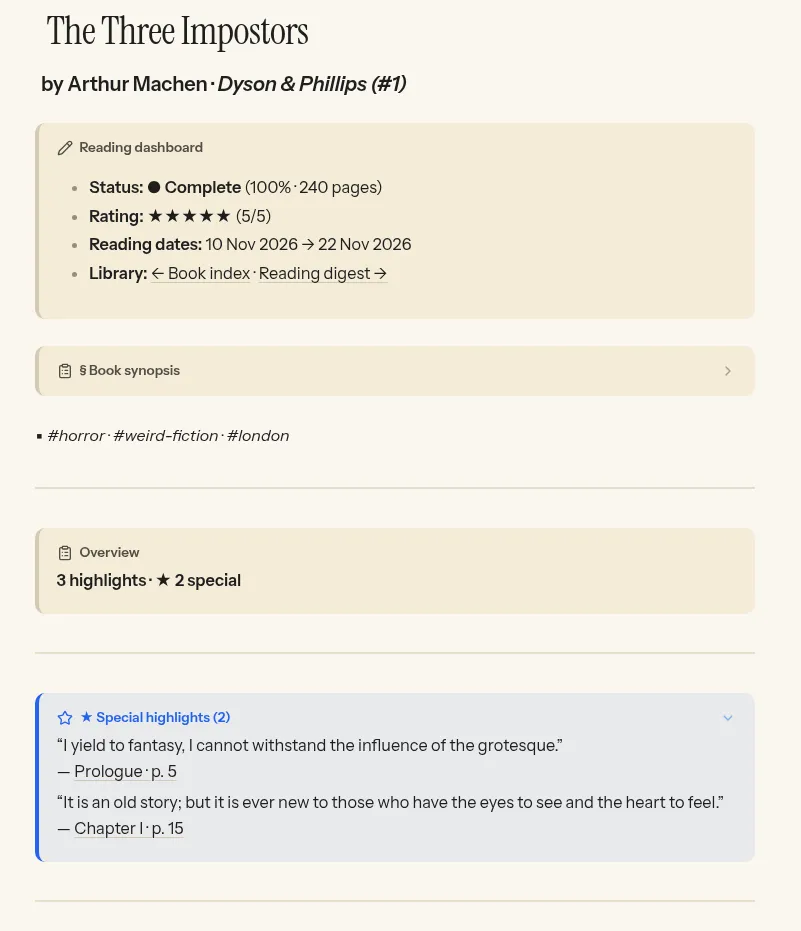
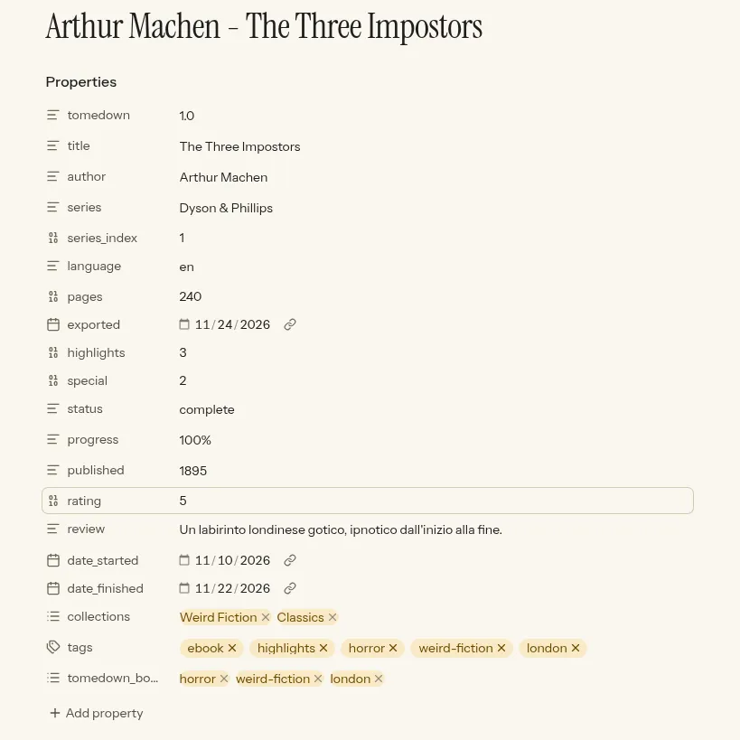
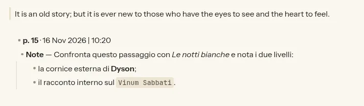
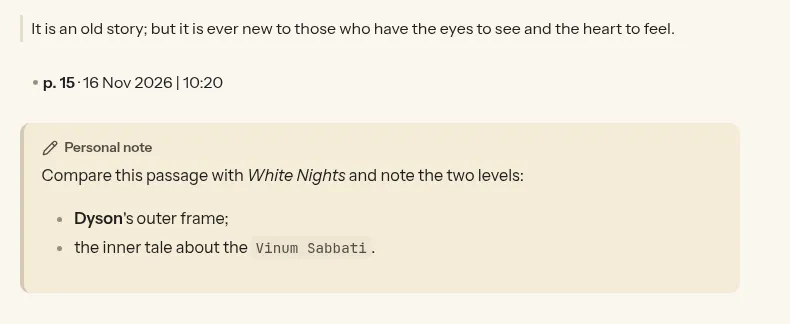
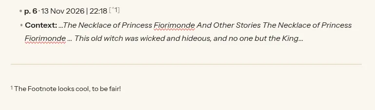
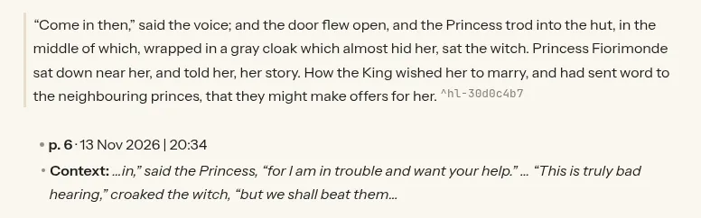
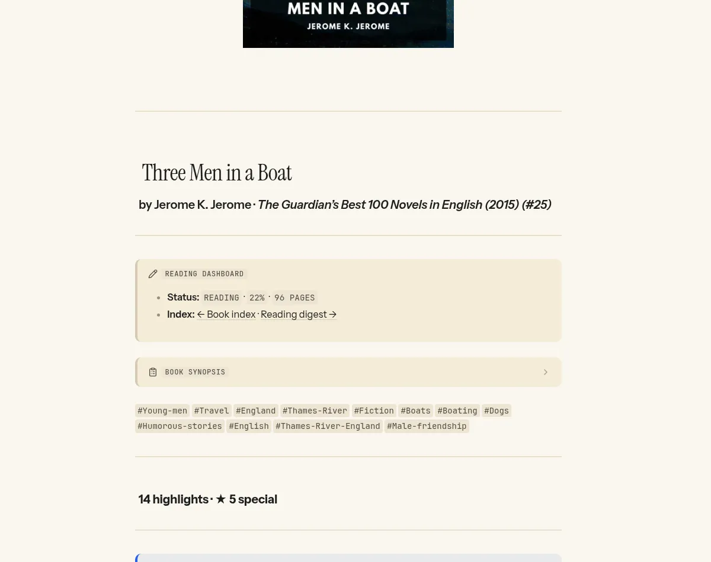
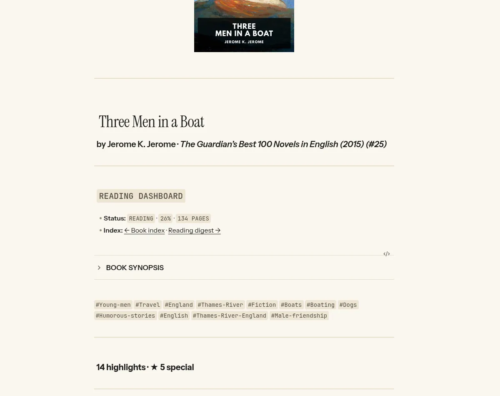
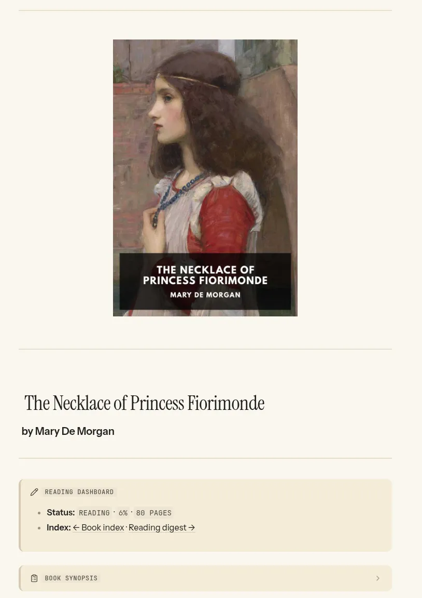
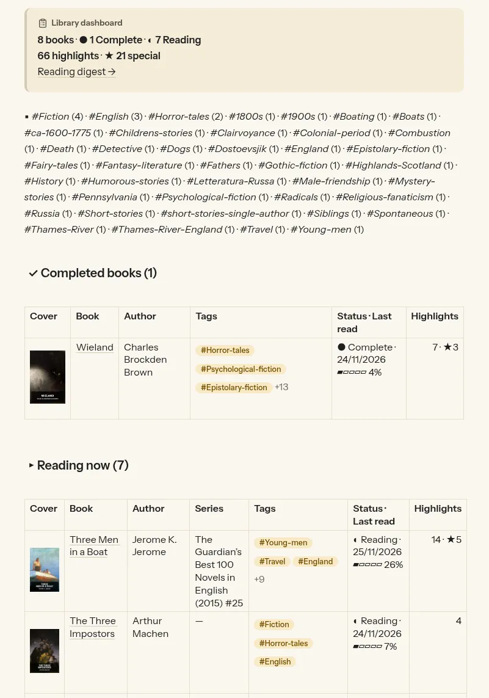

# File format & specifications

Technical specifications of the Markdown documents, frontmatter schema, and tables generated by Tomedown.

The sample below shows a book note exported with **Keep my notes for all books** enabled. In a plain export (the default), the document is identical except that the `## My notes...` heading and the HTML hash comments are omitted.

```markdown
---
tomedown: "1.0"
title: "The Three Impostors"
author: "Arthur Machen"
language: "en"
pages: 210
exported: 2026-11-16
highlights: 14
special: 2
status: "reading"
progress: "38%"
tags:
  - ebook
  - highlights
  - horror
  - weird-fiction
---
## My notes... <!-- tomedown:notes -->

<!-- tomedown:begin body hash=9e7017ad — ⛔ generated below: do not edit inside or updates stop arriving · write your notes above -->

# The Three Impostors
### by Arthur Machen

> [!book] Reading dashboard
> - **Status:** ● **Reading** (38% · 240 pages)
> - **Rating:** ★★★★☆ (4/5)
> - **Reading dates:** 10 Nov 2026 → 16 Nov 2026
> - **Index:** [[00 - Index|← Book index]]

> [!abstract]- § Book synopsis
> A gripping mystery following Mr. Dyson and Mr. Phillips through the gaslit streets of London...

▪ *#horror* · *#weird-fiction*

---

> [!summary] Overview
> **14 highlights · ★ 2 special**

---

> [!highlight]- ★ Special highlights (2)
> “It is an old story; but it is ever new to those who have the eyes to see and the heart to feel.”
> — *Chapter I · p. 15*
>
> ---
>
> “I yield to fantasy, I cannot withstand the influence of the grotesque.”
> — *Prologue · p. 5*

---

# Chapter I

> It is an old story; but it is ever new to those who have the eyes to see and the heart to feel.

- **p. 15** · 16 Nov 2026 | 10:20
  - **Note** — *to reread*

> Another highlight.

- **p. 18** · 16 Nov 2026 | 11:30

 ^hl-3a8f19bc

- **p. 25** · 16 Nov 2026 | 12:05 · ✍️ Handwritten note
  - **Note** — *Margin sketch and arrow*

---

# Page bookmarks

> Check the epilogue again

- **p. 120** · 04 Sep 2026 | 08:15

<!-- tomedown:end body -->
```

<figure class="doc-specimen">
  <div class="doc-specimen-mat">
    <div class="doc-specimen-head">
      <span class="doc-specimen-label">Obsidian · Book note header modules</span>
    </div>
    <div class="doc-specimen-viewport">
      
    </div>
  </div>
  <figcaption>Book note header modules in Obsidian: Reading dashboard, collapsible synopsis, tags, Overview, and Special highlights showcase.</figcaption>
</figure>

The sample above reflects an English interface. When running KOReader in Italian, German, French, Spanish, or Brazilian Portuguese, all exported headings and status labels are translated automatically (see [Languages](developing.md#languages)).

## Frontmatter schema

| Field | Description & origin |
|---|---|
| `title`, `author` | Metadata extracted from the book file by KOReader |
| `series`, `series_index` | Present only when the book belongs to a series |
| `language` | Two-letter or full language code |
| `pages` | Total page count |
| `exported` | Date of the latest export (`YYYY-MM-DD`) |
| `highlights`, `special` | Total highlights count and count of starred highlights |
| `status` | Reading status: `reading`, `abandoned`, or `complete` |
| `progress` | Reading position percentage, for example `"96%"` |
| `published`, `rating`, `review`, `date_started`, `date_finished`, `collections` | Extended KOReader metadata, populated when *Import book info* is used (see below) |
| `tags` | Combined list of `ebook`, `highlights`, book keywords, and tags assigned via the menu |
| `tomedown_book_tags` | Internal ledger of tags managed by Tomedown, used during merges (see below) |
| `cover` | Path to extracted cover image (e.g. `"covers/Author - Title.jpg"`), when enabled |

<figure class="doc-specimen">
  <div class="doc-specimen-mat">
    <div class="doc-specimen-head">
      <span class="doc-specimen-label">Obsidian · YAML frontmatter properties</span>
    </div>
    <div class="doc-specimen-viewport">
      
    </div>
  </div>
  <figcaption>Obsidian Properties view rendering Tomedown's structured YAML frontmatter (tags, status, progress, dates, and collections).</figcaption>
</figure>

### Frontmatter tag normalization & ledger

Every keyword is normalized into a valid Markdown/Obsidian tag:
- Spaces become hyphens (`-`).
- Punctuation characters (`;`, `'`, `=`, `[`, `]`, etc.) are stripped.
- Letters, numbers, hyphens, underscores, forward slashes, and Unicode characters (accents, emoji) are preserved.
- Tags composed purely of digits (such as `1500`) are dropped by Obsidian: use `1500s` or `year-1500` instead.

When tags are assigned via *Current book → Book info → Tags: %1*, Tomedown appends them to `tags` and records them in `tomedown_book_tags`:

```yaml
tags:
  - ebook
  - highlights
  - horror
  - psychological
tomedown_book_tags:
  - horror
  - psychological
```

Because `tomedown_book_tags` is a YAML property rather than a tag, Obsidian does not list it in its tag pane. During future exports with *Keep my notes* enabled, this ledger allows Tomedown to distinguish tags managed by KOReader from custom tags you typed manually in Obsidian, preserving your manual tags even when book tags are modified or cleared.

*Current book → Book info → Tags: %1 → Delete tags…* allows managing the global suggestion cache and removing obsolete tags from all managed books.

<a id="imported-book-information"></a>
### Extended book metadata & imported book information

Tomedown can incorporate rich metadata tracked by KOReader (ratings, reviews, reading dates, and collections). This feature is **opt-in per book** via *Current book → Book info → Import book info*, ensuring that existing notes remain untouched until you choose to import them.

```yaml
published: "1999-05"
rating: 4
review: "Riveting narrative and atmosphere."
date_started: 2026-09-10
date_finished: 2026-10-01
collections:
  - Classics
  - Favorites
```

| Field | Source in KOReader |
|---|---|
| `published` | Embedded book metadata (EPUB, PDF, MOBI, AZW3, FB2, CBZ) |
| `rating` | 1 to 5 stars assigned in KOReader |
| `review` | Personal review note recorded in KOReader reader panel |
| `date_started`, `date_finished` | Reading log calendar dates |
| `collections` | KOReader collections assigned to the volume |

To automate metadata imports across your collection, enable *Settings → Book info → Update book info automatically*.

<a id="special-highlights"></a>
## Special highlights & callouts

Marking standout passages with **Special Highlight** in KOReader differentiates them from regular quotes. In Markdown, special highlights are rendered using your configured visual marker (*Settings → Notes & highlights → Special highlight style*):

```markdown
> [!highlight]
> The line you never want to forget.
```

Obsidian, Notion, and GitHub natively render `> [!highlight]` (or `> [!IMPORTANT]`) as styled alert callouts. For plaintext editors or readers that do not support callouts, choose **Bold** (`> **quote**`) or **Star & Bold** (`> ⭐ **quote**`).

### Personal notes

Personal reflections attached to a highlight in KOReader are formatted right below the citation according to *Settings → Notes & highlights → Personal notes format* (**Inline** smart indented bullet by default, **Callout (`[!note]`)** in Obsidian, or **Footnotes** `[^1]`):

<figure class="doc-specimen">
  <div class="doc-specimen-mat">
    <div class="doc-specimen-head">
      <span class="doc-specimen-label">Obsidian · Inline personal note</span>
    </div>
    <div class="doc-specimen-viewport">
      
    </div>
  </div>
  <figcaption>Default <strong>Inline</strong> note format preserving nested bullets, emphasis, and inline code directly beneath the citation.</figcaption>
</figure>

<figure class="doc-specimen">
  <div class="doc-specimen-mat">
    <div class="doc-specimen-head">
      <span class="doc-specimen-label">Obsidian · Personal note callout</span>
    </div>
    <div class="doc-specimen-viewport">
      
    </div>
  </div>
  <figcaption>A highlight paired with <strong>Callout ([!note])</strong> in Obsidian, framing longer annotations inside a dedicated note callout.</figcaption>
</figure>

<figure class="doc-specimen">
  <div class="doc-specimen-mat">
    <div class="doc-specimen-head">
      <span class="doc-specimen-label">Obsidian · Markdown footnotes</span>
    </div>
    <div class="doc-specimen-viewport">
      
    </div>
  </div>
  <figcaption>Personal reflections gathered neatly at the foot of the document with clickable <code>[^1]</code> footnote references.</figcaption>
</figure>

### Sentence context

When *Settings → Notes & highlights → Highlight context* is enabled, Tomedown extracts the immediate sentence surroundings on reflowable documents:

```markdown
> The core insight of the chapter.

- **p. 42** · 16 Nov 2026 | 10:30
  - **Context:** *…leading thought before the sentence. …following argument after.*
```

<figure class="doc-specimen">
  <div class="doc-specimen-mat">
    <div class="doc-specimen-head">
      <span class="doc-specimen-label">Obsidian · Sentence context</span>
    </div>
    <div class="doc-specimen-viewport">
      
    </div>
  </div>
  <figcaption>Surrounding sentence context captured automatically below the quote, preserving reading flow in Obsidian.</figcaption>
</figure>

<a id="links-to-a-single-highlight"></a>
## Granular link IDs (Block references)

With *Settings → Notes & highlights → Link IDs on highlights* enabled, every highlight receives an immutable 8-character hash anchor:

```markdown
> An unforgettable observation. ^hl-4f2a9c31
```

- **Jump to quote**: `[[Book title#^hl-4f2a9c31]]`
- **Embed quote live**: `![[Book title#^hl-4f2a9c31]]`

<figure class="doc-specimen">
  <div class="doc-specimen-mat">
    <div class="doc-specimen-head">
      <span class="doc-specimen-label">Obsidian · Granular block ID (^hl-)</span>
    </div>
    <div class="doc-specimen-viewport doc-specimen-zoom-hl">
      
    </div>
  </div>
  <figcaption>Granular <code>^hl-xxxxxxxx</code> block anchor generated at the end of the quote for instant deep linking and embeds.</figcaption>
</figure>

## Markdown styles: Obsidian, Standard & CommonMark

By default, Tomedown uses **Obsidian** Markdown style (`Settings → Export → Markdown style → Obsidian`), enabling Obsidian wikilinks (`[[Book]]`), collapsible callouts (`> [!book]`, `> [!abstract]-`, `> [!highlight]-`, `> [!summary]`), and `^hl-` block IDs.

Outside Obsidian, you can choose between two portable profiles (globally in *Settings → Export* or per book in *Current book → Format & layout*):

- **Standard (GitHub / HTML)** — built for **GitHub, MarkText, Typora, and VS Code**:
  - Replaces `[!...]` callouts with clean Markdown headings (`### Reading dashboard`, `### ★ Special highlights`, `### Library dashboard`), while keeping HTML `<details>` for foldable synopses and sized `` tags for covers.
  - Uses standard `[Title](Book.md)` links, `**bold**` (or `⭐ **text**`) special highlights, and omits `^hl-` block IDs.
- **CommonMark (no HTML)** — built for **Zettlr, Pandoc, Logseq, iA Writer, and strict CommonMark pipelines**:
  - Emits **zero inline HTML tags** (`<details>`, ``, `<br>`) and zero `&nbsp;` entities across book notes, `00 - Index.md`, and `00 - Reading Digest.md`.
  - Renders book covers with pure `` syntax and extracts a compact `260×390 px` JPEG (`quality 75`) so covers stay neatly proportioned without HTML `width` attributes (switching back to *Obsidian* or *Standard* automatically re-extracts the full `800×1200 px` cover on the next export).
  - Renders synopses as `### § Book synopsis` + `> ...` blockquotes, formats `00 - Index.md` as nested Markdown lists, and uses `_..._` single emphasis for lint-clean Zettlr compatibility.

<figure class="compare-figure">
  <div class="compare-mat">
    <div class="doc-specimen-head">
      <span class="doc-specimen-label">Obsidian style vs. Standard Markdown</span>
    </div>
    <div class="compare-slider" data-compare style="--split: 50%;" data-edge="mid">
      <div class="compare-pane compare-before">
        
        <span class="compare-badge compare-badge-left">Obsidian</span>
      </div>
      <div class="compare-pane compare-after">
        
        <span class="compare-badge compare-badge-right">Standard Markdown</span>
      </div>
      <div class="compare-divider" aria-hidden="true">
        <span class="compare-handle">
          <svg width="16" height="16" viewBox="0 0 24 24" fill="none" stroke="currentColor" stroke-width="2.3" stroke-linecap="round" stroke-linejoin="round"><polyline points="9 18 3 12 9 6"/><polyline points="15 6 21 12 15 18"/></svg>
        </span>
      </div>
      <input type="range" class="compare-range" min="0" max="100" step="0.1" value="50" aria-label="Drag left or right to compare Obsidian style on the left with Standard Markdown on the right" />
    </div>
  </div>
  <figcaption>Drag the central handle left or right to compare the same book note header (cover, Reading dashboard, Book synopsis, and tags) in <strong>Obsidian</strong> versus <strong>Standard Markdown</strong>.</figcaption>
</figure>

## Covers

With *Settings → Notes & highlights → Book page → Book cover* (or *Current book → Format & layout → Book page → Book cover*) enabled, Tomedown extracts the cover image into your vault (`covers/` by default, or any flat or nested path up to 3 levels such as `assets/covers` for Logseq/Obsidian in *Settings → Export → File names & folders → Covers folder*) as an `800×1200` JPEG in **Obsidian** / **Standard** modes (or a compact `260×390` JPEG with pure `` syntax in **CommonMark** mode, resizing automatically whenever you switch profiles and re-export). When books are organized into subfolders (*By author*, *By series*, or *By reading status*), relative links (`../assets/covers/...`) and cloud WebDAV directories are resolved automatically:

```markdown
---
cover: "covers/Arthur Machen - The Three Impostors.jpg"
---


```

<figure class="doc-specimen is-fade-bottom">
  <div class="doc-specimen-mat">
    <div class="doc-specimen-head">
      <span class="doc-specimen-label">Obsidian · Book cover &amp; Code badges style</span>
    </div>
    <div class="doc-specimen-viewport">
      
    </div>
  </div>
  <figcaption>Extracted cover artwork rendered at the top of the book note above the title and reading modules (shown here with the <strong>Code badges</strong> section style).</figcaption>
</figure>

## The index (`00 - Index.md`)

`00 - Index.md` acts as your personal library catalog in Obsidian:

```markdown
| Cover | Book | Author | Series | Status | Last read | Highlights |
|:---:|---|---|---|---|:---:|:---:|
|  | [[Edgar Wallace - The Three Just Men\|The Three Just Men]]<hr>#mystery #crime | Edgar Wallace | The Four Just Men #4 | ● **Complete**<br>▰▰▰▰▰&nbsp;100%<br>★★★★★ | 16/11/2026 | 22 · ★5 |
```

### Library index sections

Under *Settings → Index & library*, you can enable modular components in `00 - Index.md`:

- **Completed books**: adds a `### Completed books` section listing every finished book in your library with its rating, completion date, and highlight count.
- **Library dashboard**: inserts an overview summary table displaying total books, volumes in progress, finished books, and total highlight count.
- **Tag cloud**: generates an alphabetical directory of all tags across your library with book count badges.
- **Tags display**: choose between **Show all**, **First 3 (+N)**, or **Collapsible (<details>)** to fold extensive tag lists behind an expandable HTML `<details>` summary.

<figure class="doc-specimen is-fade-bottom">
  <div class="doc-specimen-mat">
    <div class="doc-specimen-head">
      <span class="doc-specimen-label">Obsidian · 00 - Index.md</span>
    </div>
    <div class="doc-specimen-viewport">
      
    </div>
  </div>
  <figcaption><code>00 - Index.md</code> in Obsidian: Library dashboard, Tag cloud, and Completed books trophy room.</figcaption>
</figure>

## Handwritten notes & Stylus drawings

For devices equipped with a stylus (Kindle Scribe, Kobo Sage/Elipsa, Android e-ink, or via KOReader's `pencil.koplugin`), Tomedown automatically discovers handwritten annotations in the book's `.sdr` directory:

1. **Drawing Extraction**:
   - Vector drawings (point-sequence strokes) are transformed into scalable, sharp **SVG** vector files via a pure Lua vector generator.
   - Raster drawings (e.g. pencil PNGs) are extracted with transparent borders.
   - Images are placed into the `drawings/` folder inside your vault (customizable via *Settings → Export → File names & folders → Drawings folder*, including nested paths up to 3 levels such as `assets/drawings` with automatic file migration).
2. **Standard Markdown Embeds**:
   - In the book note, drawings are embedded natively using standard Markdown image syntax.
   - Each drawing receives an Obsidian block ID (`^hl-...`), allowing you to link directly to or embed the handwritten drawing anywhere in your vault: `![[Book Title#^hl-3a8f19bc]]`.
   - Any text note attached to the stylus annotation in KOReader appears right below as a formatted user note.

```markdown
 ^hl-3a8f19bc

- **p. 25** · 16 Nov 2026 | 12:05 · ✍️ Handwritten note
  - **Note** — *Margin sketch and arrow*
```

## Reading Digest (`00 - Reading Digest.md`)

When *Reading digest (00 - Reading Digest.md)* is enabled in *Settings → Export* (or exported on demand via *Tomedown → All books → Export reading digest*), Tomedown compiles a chronological reading journal grouping all highlights across your whole library by day:

```markdown
---
tomedown: "1.0"
title: "Reading digest"
exported: 2026-11-16
highlights: 25
tags:
  - ebook
  - digest
---

# Reading digest

> *"Welcome to the quiet space where authors' thoughts linger, and your own reflections take shape."*

---

**2 books** · **25 highlights** · **★ 4 special**

## 16 Nov 2026

### [[Arthur Machen - The Three Impostors|The Three Impostors]] — *Arthur Machen*

> I certainly think,” replied Phillipps, “that, if you pull out that coin...

- *Adventure of the Gold Tiberius* · **p. 11** · 09:41

> Phillipps,” replied the elder and (it must be said) the more pompous of the two...

- *Prologue* · **p. 5** · 09:41

---

### [[Edgar Wallace - The Three Just Men|The Three Just Men]] — *Edgar Wallace*

> Her eyes went rapidly down the “Wanted to Buy” column.

- *I: The Firm of Oberzohn* · **p. 3** · 09:29
```

Key features of the Reading Digest:
- **Literary Date Headings**: `## 16 Nov 2026` groups quotes chronologically by day.
- **Clean Timestamps**: Under each quote, only the time of capture (`09:41`) is displayed, avoiding repetitive date text.
- **Divider Between Books**: A clean rule `---` separates different volumes read on the same calendar day.
- **Overview Block Support**: Adopts your configured *Overview style* (Inline, Blockquote, Callout, Table) for library stats.
