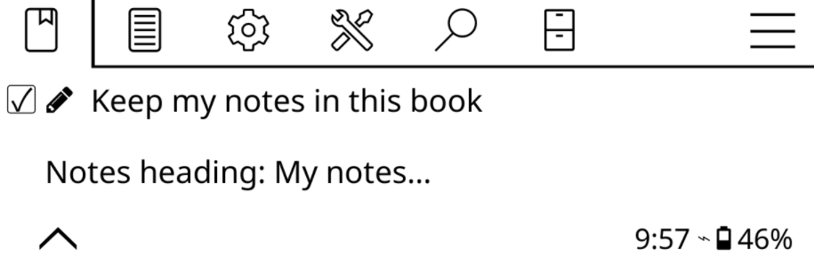

# Keep my notes

[Back to the README](../README.md).

Your vault is the destination, not a cache. Since 1.0 an export can fold the
new render into the file already in your vault instead of overwriting it.
**Keep my notes: all books** is off by default (what every release up to 0.8
always did), so upgrading changes nothing: turn it on in
*Settings → My notes* and the file becomes a shared document.



## The switches

### All books

*Keep my notes: all books* is the global switch, and while it is on there is
nothing else to decide: it alone is in charge of every file, every file
keeps its zone, and *Notes heading: %1* names all of them. The keep row in
*Current book* is still there, off, with *On for all books* on the right, so
the choice a book stored stays visible without being in charge. The
per-book heading and the index rows leave the menus, and the choices behind
them stay stored, waiting for the switch to go off again.

### One book

Since 1.1 the choice is also **per book**, with the global switch off.
*Keep my notes in this book*, in the open book's menu, keeps the zone for
that book alone, and the choice survives later flips of the global switch.
Tapping it again asks first, saying the file goes back to a plain export;
confirming stores an explicit off and writes that file plain there and then,
with the one you had kept whole as `.bak` first. That copy comes back into
the file the next time you turn Keep my notes on, which is what makes the
box's promise true. While a book keeps a zone its menu grows a second row,
*Notes heading: %1*, which names that book's zone and no other file's. The
rows of *Settings → My notes* keep speaking about the global switch only:
*Notes heading: %1* appears while it is ticked, whatever the books chose,
because a book's own choice lives in the book's own menu.

### The index

`00 - Index.md` follows the same shape. With the global switch off, its own
switch, *Keep my notes: index*, sits in *Settings → My notes* under the
global one, with *Index notes heading: %1* under it to name the zone. The
index starts out the way the global switch is set, and no book turns it on
behind your back any more, so exporting a book never takes the notes you
wrote in the index away by surprise. Turn its switch off and the index
exports plain from the next export on, with the one you had kept whole as
`00 - Index.md.bak` first; turn it on again and that copy comes back. With
the global switch on, both of its rows are hidden.

## The zone and the block

Every file holds one generated block. With the toggle on, the block is
wrapped in two invisible HTML comments Tomedown uses as handles, under the
heading the plugin owns and with its tag. The plain export writes none of
that: no comments, no tag, no heading, nothing to merge when every run
overwrites.

```markdown
---
title: "Blackwater"
…
---

## My notes... <!-- tomedown:notes -->

your own intro, links, thoughts: everything under the heading
and outside the block is yours

<!-- tomedown:begin body hash=54dc6b6b — ⛔ generated below: do not edit inside or updates stop arriving · write your notes above -->

---

# **150 highlights · ★ 42 special**

# Chapter I

> First highlighted sentence.

- **p. 10** · 02/09/2026
<!-- tomedown:end body -->
```

Obsidian and every Markdown renderer ignore the comments, so the file looks
exactly the same. The begin comment carries the digest (`hash=…`) of the
block it wraps, the proof Tomedown compares against to tell a touched block
from one of its own at a glance.

On every export:

- text you wrote **outside** the block (under the heading, below the end
  comment, your own frontmatter properties) is carried over untouched,
  wherever it sits;
- the block itself is always regenerated: new highlights, page bookmarks,
  the highlight recap heading, the index;
- the heading is the plugin's line (with Keep my notes on, the
  `<!-- tomedown:notes -->` tag gives it away). Renamed from *Notes heading:
  %1* (*Settings → My notes*), it is rewritten on the next export while your
  text below it stays put. Leave the setting empty and files export without a
  heading; with Keep my notes off they export without one at all (the next
  run would take it, and anything written under it, away);
- the zone around it breathes: **two blank lines** under the heading and two
  above the marker, so there is room to start writing. Nothing else is put in
  your way (the invitation older builds seeded an empty zone with is dropped
  at the next merge). The [Obsidian guide](../OBSIDIAN.md) walks through the
  file as it sits in the vault, with and without the toggle;
- the frontmatter merges field by field: Tomedown's own fields (`status`,
  `progress`, `exported`…) always show KOReader's values, your tags are kept
  and unioned with the new ones, and a property only you added (`rating: 5`,
  an alias…) survives, even a line the parser cannot place is kept verbatim
  at the end.

With Keep my notes off the file is regenerated at every export. Text typed
into it can only be kept when Keep my notes comes back on, and lands in
`.bak.1`; an export while Keep my notes is still off overwrites it.

## The two copies

**The `.bak` is your file, set aside.** When Keep my notes goes off, the
zoned file, notes included, is kept as `<name>.md.bak` while the plain export
takes its place. There is one `.bak` and it is always the latest: turning
Keep my notes on again makes it the base of the next export, so your notes
are back. On, off, on, off, on: every note you kept is back each time, and
one you deleted stays deleted. A `.bak` is never copied twice and never grows
a twin beside it. A card that ran the 1.1.0-beta.1 finds its two copies back
in the right slots on the first export.

**`<name>.md.bak.1` is the safety copy**, only for text that cannot come back
by itself: something typed into the plain file while Keep my notes was off
(that file is regenerated, so the text cannot join the zone), a block edited
inside its comments, a cloud copy that moved on. It has one slot and never
takes the place of the `.bak`.

A file Tomedown itself wrote is never copied. When an export finds the very
bytes the last run left there, nothing of yours sits in them, so no safety
copy is taken (the first run after an upgrade has not seen your file yet and
keeps one copy, just in case).

If a copy cannot be written (a full card, a read-only folder) the file is
**left as it is** and the export reports the error: a note is never traded
for a rewrite. The next export tries again.

A block you edited **inside** the comments is not a lost cause. The previous
file is kept as `<name>.md.bak.1` before the rewrite, so your line waits in
the safety copy while the fresh block joins in (the toast reports `N files
backed up (.bak)`). A file that has to be rebuilt from scratch (markers
broken beyond repair, an export from tomedown ≤ 0.8) comes with the same
copy.

## Two devices on one folder

With two readers on one cloud folder: while Keep my notes is off the export
does not read the cloud copy, so a plain file edited on another device is
replaced by the upload, as it always was. Turn Keep my notes on and the cloud
copy is read: if it is a plain file edited elsewhere, its text is kept as
`.bak.1` and the `.bak` of this device is the one that comes back, because
the file on the device is the one that counts. A cloud copy that has a zone
is merged as usual; when this device also holds notes set aside in `.bak`
that the cloud copy never got, they are folded into it, so neither side is
left behind, and what the rewrite replaces is kept as `.bak.1` first (the
plain file instead, when it holds text you typed yourself).

## Editing in Obsidian while the device is away

If you export to the cloud and keep the vault in sync (WebDAV, Dropbox, FTP,
Nextcloud or Remotely Save), you can write in Obsidian on the desktop and
keep reading on the device. The two sides write the same file, so the export
has to know which copy is newer. Otherwise every export would fold the new
highlights into the older copy on the device and push it over the notes you
just wrote.

With **Bring in edits made in Obsidian** on (the default, it lives in
*Settings → My notes*), an export fetches the copy in the cloud before
folding the render in, and uses it as the base when it has changed since the
last upload Tomedown made. The notes you wrote in Obsidian survive, the fresh
highlights join them, and the file goes back to the cloud with the device up
to date. The fetch only happens for the files being exported, and only while
there is a connection.

A few things worth knowing:

- with *Keep my notes: all books* off (the default) every export overwrites
  the file, so the toggle has nothing to merge and does nothing. Turn Keep my
  notes on to let your notes ride along;
- the first export into a folder that already has files adopts the cloud copy
  as the base, so an existing vault is not overwritten on the first run;
- turn the toggle off if you would rather have the device always win (for
  example when the cloud folder is a backup and never edited elsewhere);
- **the offline window is safe too**. An export made with no connection
  writes the highlights into the file on the device and queues it. When the
  connection comes back, before that file is pushed, Tomedown fetches the
  cloud copy and compares it with the one it last sent. If you wrote in
  Obsidian in the meantime, that copy is folded into the file first, so the
  notes ride along with the new highlights instead of being overwritten. If a
  transient error stops the fetch, the file is held back and retried at the
  next chance rather than pushed blind: nothing is lost in either direction;
- the same guard runs while you are online. An export or an upload whose
  cloud copy cannot be read keeps that file out of the push and queues it for
  the retry, and *Upload all files again* runs the same comparison before
  pushing. A server that cannot download has nothing to compare against and
  receives the local copy as it is; with *Bring in edits made in Obsidian*
  off, the copy on the device always wins.

## Backup copies…

Inside a book, *Backup copies…* in the Tomedown menu lists the copies that
sit beside that book's file (the notes set aside and the safety copy, each
with the day it was saved) and deletes one when you tap it and confirm. The
box says what the copy holds, and warns when the notes set aside are the only
place those notes are right now. The row appears only while the book has a
copy, and leaves with the last one.

The result toast and the *Last export* popup report the backups of the last
run: `%1 files backed up (.bak)`.

## Good to know

- don't move or delete the `<!-- tomedown:begin … -->` comments (they only
  exist with Keep my notes on). A marker line you broke is repaired around
  your zone on the next export; a deleted one still recovers the zone (with a
  `.bak` alongside); a file with no markers at all is **adopted**: its text
  becomes the zone above the block and the block joins in, nothing is lost
  (an export from tomedown ≤ 0.8 is rebuilt once the same way, then behaves
  like every other file);
- files in the old three-region layout (preamble, highlights, bookmarks) are
  migrated once: your zones move above and below the new single block, the
  old generated content is dropped (the render has it again), and a region
  you had edited survives only in the `.bak` written alongside;
- markers from older builds carry no hash: for them the fingerprint from the
  last export decides whether the block counts as edited (with none to
  compare, the block counts as ours).
