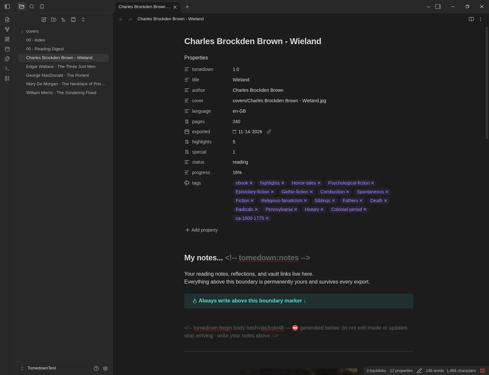

# Keep my notes

[Back to the README](../README.md).

Your vault is the destination, not a cache. Since 1.0 an export can fold the
new render into the file already in your vault instead of overwriting it.
**Keep my notes for all books** is off by default (what every release up to 0.8
always did), so upgrading changes nothing: turn it on in
*Settings → My notes* and the file becomes a shared document.

## The switches

### All books

*Keep my notes for all books* is the global switch, and while it is on there is
nothing else to decide: it alone is in charge of every file, every file
keeps its zone, and *Notes heading: %1* names all of them. The keep row in
*Current book* is still there, off, with *On for all books* on the right, so
the choice a book stored stays visible without being in charge. *Keep my notes in the index* also shows *On for all books* on the right, while the per-book heading and index heading rows are hidden and their stored choices wait for the global switch to go off again.

### One book

Since 1.1 the choice is also **per book**, with the global switch off.
*Keep my notes in this book*, in the open book's menu (*Tomedown → Current book*), keeps the zone for
that book alone, and the choice survives later flips of the global switch.
Tapping it again asks first, saying the file goes back to a plain export;
confirming stores an explicit off and writes that file plain there and then,
with the one you had kept whole as `.bak` first. That copy comes back into
the file the next time you turn Keep my notes on, which is what makes the
box's promise true. While a book keeps a zone its menu grows a second row,
*Notes heading: %1*, which names that book's zone and no other file's. The
rows of *Settings → My notes* keep speaking about the global switch only:
*Notes heading: %1* appears while it is ticked, whatever the books chose,
because a book's own choice lives in the book's own menu.

### The index

`00 - Index.md` follows the same shape. With the global switch off, its own
switch, *Keep my notes in the index*, sits in *Settings → My notes* under the
global one, with *Index notes heading: %1* under it to name the zone. The
index starts out the way the global switch is set, and no book turns it on
behind your back any more, so exporting a book never takes the notes you
wrote in the index away by surprise. Turn its switch off and the index
exports plain from the next export on, with the one you had kept whole as
`00 - Index.md.bak` first; turn it on again and that copy comes back. With
the global switch on, *Keep my notes in the index* is disabled with *On for all books* on the right.

### Tags for one book

*Tags: %1*, inside *Tomedown → Current book → Book info*, holds the tags of that book alone. The
dialog lists the tags already used in your library, most used first: tap one
to add it, tap it again to remove it. *Other tags…* opens the comma-separated
field for a tag nobody has used yet, and *Clear all tags* empties the list.
The chosen tags join `ebook`, `highlights` and the book's own keywords at the
next export (right away when the book is exported on close). A tag made only
of digits (`1500`) is ignored, because Obsidian does not accept it: use
`1500s` or `anno-1500`.

With Keep my notes on, the file carries `tomedown_book_tags`, the receipt of
the tags the menu owns. A tag you remove there leaves `tags` at the next
export even while the rest of the file is merged; a tag you write by hand in
Obsidian is not in the receipt and survives. Clearing the field removes both
the managed tags and the receipt; with Keep my notes on, the clear is
recorded as an empty ledger (`tomedown_book_tags: []`) so the next merge
knows to drop the old ones.

### Where a book goes

*Book visibility: %1 ▸*, in *Tomedown → Current book*, opens a radio submenu to choose what the next exports do with
that book: **Export and show in the index** (*Normal*), **Export, but hide from the index** (*Hidden from index*), or
**Do not export** (*Not exported*). The note already written is never deleted, and the choice
belongs to the book, so it survives later exports of the rest of the library.
*Export this book*, tapped on purpose, still works for a book set to *Do not export*.
The same row sits in KOReader's file dialog when you long-press a
book in the file browser, in History or in Bookshelf, together with *Tags…*.

## The zone and the block

Every file holds one generated block. With the toggle on, the block is
wrapped in two invisible HTML comments Tomedown uses as handles, under the
heading the plugin owns and with its tag. The plain export writes none of
that: no comments, no tag, no heading, nothing to merge when every run
overwrites.

```markdown
---
title: "The Three Impostors"
…
---

## My notes... <!-- tomedown:notes -->

your own intro, links, thoughts: everything under the heading
and outside the block is yours

<!-- tomedown:begin body hash=54dc6b6b — ⛔ generated below: do not edit inside or updates stop arriving · write your notes above -->

---

# **150 highlights · ★ 42 special**

# Chapter I

> First highlighted sentence.

- **p. 10** · 02/09/2026
<!-- tomedown:end body -->
```

<figure class="doc-shot">
  <div class="doc-shot-frame">
    
  </div>
  <figcaption>Personal reflections written above the generated block survive every export without being overwritten.</figcaption>
</figure>

Obsidian and every Markdown renderer ignore the comments, so the file looks
exactly the same. The begin comment carries the digest (`hash=…`) of the
block it wraps, the proof Tomedown compares against to tell a touched block
from one of its own at a glance.

On every export:

- text you wrote **outside** the block (under the heading, below the end
  comment, your own frontmatter properties) is carried over untouched,
  wherever it sits;
- the block itself is always regenerated: new highlights, page bookmarks,
  the highlight recap heading, the index;
- the heading is the plugin's line (with Keep my notes on, the
  `<!-- tomedown:notes -->` tag gives it away). Renamed from *Notes heading:
  %1* (*Settings → My notes*), it is rewritten on the next export while your
  text below it stays put. Leave the setting empty and files export without a
  heading; with Keep my notes off they export without one at all (the next
  run would take it, and anything written under it, away);
- the zone around it breathes: **two blank lines** under the heading and two
  above the marker, so there is room to start writing. Nothing else is put in
  your way (the invitation older builds seeded an empty zone with is dropped
  at the next merge). The [Obsidian guide](../OBSIDIAN.md) walks through the
  file as it sits in the vault, with and without the toggle;
- the frontmatter merges field by field: Tomedown's own fields (`status`,
  `progress`, `exported`…) always show KOReader's values, your tags are kept
  and unioned with the new ones (a tag removed from the book's menu leaves
  through its `tomedown_book_tags` receipt, see
  [Tags for one book](#tags-for-one-book)), and a property only you added
  (`mood: "cupo"`, an alias…) survives, even a line the parser cannot place is
  kept verbatim at the end. Once a book's information is imported, Tomedown
  also owns `published`, `rating`, `review`, `date_started`, `date_finished`
  and `collections` for that book: it writes them and removes them again when
  you stop managing it (see [File format](file-format.md#imported-book-information)).

With Keep my notes off the file is regenerated at every export. Text typed
into it can only be kept when Keep my notes comes back on, and lands in
`.bak.1`; an export while Keep my notes is still off overwrites it.

### At a glance: where you write → what happens on the next export

| Where you write or edit | Keep my notes **ON** | Keep my notes **OFF** |
|---|---|---|
| **Above** `<!-- tomedown:begin body ... -->` (under the notes heading) | Preserved in place | Overwritten (kept in `.bak` when turning the switch off; comes back when turned on again) |
| **Below** `<!-- tomedown:end body -->` (at the bottom of the file) | Preserved in place | Overwritten |
| **Custom frontmatter keys** (`aliases`, `cssclasses`, `mood`, …) | Preserved verbatim | Overwritten |
| **Manual tags** added in `tags:` | Preserved and unioned with KOReader's tags | Overwritten |
| **Personal comment directly below a quote** (after `- **p. X** …`) | Preserved and re-attached under that same quote on the next export | Overwritten |
| **Other edits inside** the generated block (`begin` … `end`) | Rebuilt from KOReader; your previous file is saved in `.bak.1` (rotating up to `.bak.3`) | Overwritten |
| **Damaged or missing markers** / plain note created in Obsidian | Adopted or recovered: your notes stay in the head zone and a safety copy is kept in `.bak.1` when needed | Overwritten |
| **Windows CRLF (`\r\n`) or UTF-8 BOM** added by an external editor | Normalized and merged cleanly with no spurious backup | Overwritten |

## The backup copies

**The `.bak` is your file, set aside.** When Keep my notes goes off, the
zoned file, notes included, is kept as `<name>.md.bak` while the plain export
takes its place. There is one `.bak` and it is always the latest: turning
Keep my notes on again makes it the base of the next export, so your notes
are back. On, off, on, off, on: every note you kept is back each time, and
one you deleted stays deleted. A `.bak` is never copied twice and never grows
a twin beside it.

**`<name>.md.bak.1` (up to `.bak.3`) are the safety copies**, only for text
that cannot come back by itself: something typed into the plain file while
Keep my notes was off (that file is regenerated, so the text cannot join the
zone), a block edited inside its comments, a format or region-shape migration
on an edited block, or a cloud copy that moved on. Up to three safety slots
(`.bak.1`, `.bak.2`, `.bak.3`) are rotated automatically so two consecutive
rewrites never overwrite an earlier safety copy, and they never take the
place of the `.bak`.

A file Tomedown itself wrote is never copied. When an export finds the very
bytes the last run left there, nothing of yours sits in them, so no safety
copy is taken.

If a copy cannot be written (a full card, a read-only folder) the file is
**left as it is** and the export reports the error: a note is never traded
for a rewrite. The next export tries again.

## Two devices on one folder

With two readers on one cloud folder: while Keep my notes is off the export
does not read the cloud copy, so a plain file edited on another device is
replaced by the upload, as it always was. Turn Keep my notes on and the cloud
copy is read: if it is a plain file edited elsewhere, its text is kept as
`.bak.1` and the `.bak` of this device is the one that comes back, because
the file on the device is the one that counts. A cloud copy that has a zone
is merged as usual; when this device also holds notes set aside in `.bak`
that the cloud copy never got, they are folded into it, so neither side is
left behind, and what the rewrite replaces is kept as `.bak.1` first.

## Editing in Obsidian while the device is away

If you export to the cloud and keep the vault in sync (WebDAV, Dropbox, FTP,
Nextcloud or Remotely Save), you can write in Obsidian on the desktop and
keep reading on the device. The two sides write the same file, so the export
has to know which copy is newer.

With **Bring in edits made in Obsidian** on (the default, in
*Settings → My notes*), an export fetches the copy in the cloud before
folding the render in, and uses it as the base when it has changed since the
last upload Tomedown made. The notes you wrote in Obsidian survive, the fresh
highlights join them, and the file goes back to the cloud with the device up
to date.

A few things worth knowing:

- with *Keep my notes for all books* off (the default) every export overwrites
  the file, so the toggle has nothing to merge and does nothing. Turn Keep my
  notes on to let your notes ride along;
- the first export into a folder that already has files adopts the cloud copy
  as the base, so an existing vault is not overwritten on the first run;
- turn the toggle off if you would rather have the device always win (for
  example when the cloud folder is a backup and never edited elsewhere);
- **the offline window is safe too**. An export made with no connection
  writes the highlights into the file on the device and queues it. When the
  connection comes back, before that file is pushed, Tomedown fetches the
  cloud copy and compares it with the one it last sent. If you wrote in
  Obsidian in the meantime, that copy is folded into the file first, so the
  notes ride along with the new highlights instead of being overwritten;
- the same guard runs while you are online. *Settings → Cloud upload → Re-upload all files…* runs the same comparison before pushing.

## Backup copies

Inside a book, **Backup copies** in the Tomedown menu (`Current book → Backup copies`) lists the copies that sit beside that book's file and allows you to inspect and delete them (and `Settings → Export → Backup copies` lists all backups across your entire library):

```text
Current book
└── Backup copies
    ├── Saved notes      → file .bak   (preserved personal notes)
    ├── Latest snapshot  → file .bak.1 (latest emergency snapshot)
    └── Snapshot 2       → file .bak.2 (previous snapshot in rotation)
```

- **Saved notes (`.bak`)**: the zoned file parked when you turned *Keep my notes* off for this book. It restores your personal notes automatically when *Keep my notes* is turned back on.
- **Safety copies (`.bak.1`, `.bak.2`, `.bak.3`)**: automatic snapshots created before an external overwrite, when merging incoming edits from Obsidian, or when recovering hand edits made inside the generated block. Tomedown keeps up to three generations in FIFO rotation (`.bak.1` newest, `.bak.2` earlier, `.bak.3` oldest).

Tapping any copy opens KOReader's confirmation dialog displaying its modification date, exact time, file size, and a warning if the saved notes copy is the only place those notes exist right now.

## Good to know

- don't move or delete the `<!-- tomedown:begin … -->` comments (they only
  exist with Keep my notes on). A marker line you broke is repaired around
  your zone on the next export; a deleted one still recovers the zone (with a
  `.bak` alongside); a file with no markers at all is **adopted**: its text
  becomes the zone above the block and the block joins in, nothing is lost;
- files in the old three-region layout (preamble, highlights, bookmarks) are
  migrated once: your zones move above and below the new single block, the
  old generated content is dropped (the render has it again), and a region
  you had edited survives only in the `.bak` written alongside.
