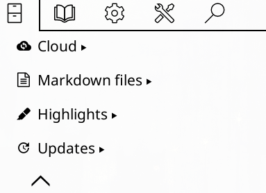
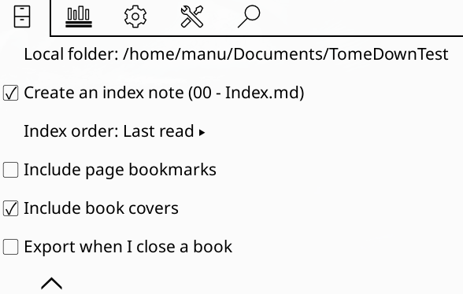
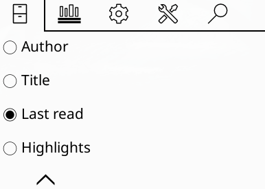
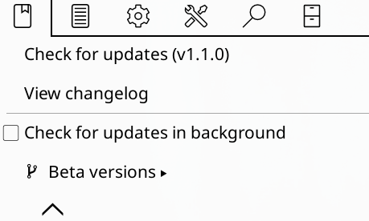
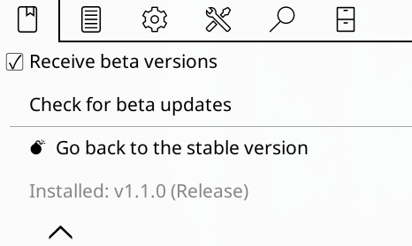

# Settings

[Back to the README](../README.md).

☰ menu → **Tomedown** → **Settings**, in seven groups:

Everything here is stored in KOReader's settings and applies to every book.
The per-book choice, heading, tags and imported book information live in the
book's own menu: see [Keep my notes](keep-my-notes.md) and
[File format](file-format.md#imported-book-information).

## Files

<!-- SCREENSHOT_PLACEHOLDER: assets/menu/settings/markdown_menu.png -->
> [!NOTE] **[SCREENSHOT DA REALIZZARE: Menu Impostazioni → File]**
> - **File di destinazione:** `assets/menu/settings/markdown_menu.png`
> - **Inquadratura:** Schermata intera menu KOReader su Kindle / e-reader.
> - **Percorso Kindle:** Menu ☰ → *Tomedown* → *Impostazioni* → *File*.
> - **Voci da mostrare:** Cartella locale, Struttura cartelle, *Crea un digest di lettura (00 - Reading Digest.md)*, Esporta alla chiusura, Formato esportazione (.md/.txt), Copie di backup, *Esporta impostazioni su file*, *Ripristina impostazioni da backup…*.

| Entry | What to do |
|---|---|
| *Local folder* | defaults to `clipboard/tomedown` inside KOReader's data folder; tap it to browse with KOReader's folder picker (long-press a folder to choose it) |
| *Folder layout: %1* | structure of your vault: **Flat** (all books in the root folder, the default), **By author** (`Author/Book.md`), or **By reading status** (`Reading/`, `Complete/`, `Abandoned/`) |
| *Create a reading digest (00 - Reading Digest.md)* | off by default: creates a consolidated chronological digest (`00 - Reading Digest.md`) grouping highlights across all books by day, with literary dates (`16 Nov 2026`) and clean quote times (`09:41`) |
| *Export when I close a book* | off by default: exports the book when you close it, and again (silently, no network) before the device suspends |
| *Export format: %1* | defaults to **Markdown (.md)**; can be switched to **Plain text (.txt)** or **Both (.md and .txt)** to generate a clean, human-readable `.txt` file per book without YAML or HTML |
| *Backup copies (%1)* | opens the backups submenu listing existing backup copies with transparent labels and real file dates (`Saved notes · 16 Nov 26`, `Latest snapshot · 14 Nov 26`). Includes **Delete all backups…** to clean stale copies across your library with a single confirmation |
| *Export settings to file* | exports all Tomedown configuration options deterministically to `tomedown_settings_backup.lua` inside your local export folder |
| *Restore settings from backup…* | safely restores your Tomedown configuration from `tomedown_settings_backup.lua` with a confirmation dialog |

<!-- SCREENSHOT_PLACEHOLDER: assets/menu/settings/confirm_delete_backups.png -->
> [!NOTE] **[SCREENSHOT DA REALIZZARE: Finestra Conferma Pulizia Backup]**
> - **File di destinazione:** `assets/menu/settings/confirm_delete_backups.png`
> - **Inquadratura:** Popup di conferma centrato a schermo.
> - **Percorso Kindle:** *Tomedown* → *Impostazioni* → *File* → *Copie di backup* → *Elimina tutti i backup…*.
> - **Dettaglio:** Mostra il messaggio con il conteggio dei file trovati: *"Eliminare tutti i N file di backup (*.bak) nella cartella locale? Le note esportate non verranno toccate."*.

## Index

<!-- SCREENSHOT_PLACEHOLDER: assets/menu/settings/index_menu.png -->
> [!NOTE] **[SCREENSHOT DA REALIZZARE: Menu Impostazioni → Indice]**
> - **File di destinazione:** `assets/menu/settings/index_menu.png`
> - **Inquadratura:** Schermata del gruppo Indice su KOReader.
> - **Percorso Kindle:** Menu ☰ → *Tomedown* → *Impostazioni* → *Indice*.
> - **Voci da mostrare:** *Crea una nota indice (00 - Index.md)*, Ordinamento indice, Layout indice, Link indice, *Mostra Sto leggendo nell'indice*, *Visualizzazione tag nell'indice*, *Mostra libri completati nell'indice*, *Mostra bacheca libreria nell'indice*, *Mostra nuvola di tag nell'indice*.

| Entry | What to do |
|---|---|
| *Create an index note (00 - Index.md)* | on by default: builds the Obsidian tables: a stats line on top, then series books and the rest, each with the columns it actually has (links, author, series, highlights with stars, tags, status over the progress bar, last read) |
| *Index order: %1* | the order of the *My books* table: **Author** (the default), **Title**, **Last read** or **Highlights**. Last read and highlights run newest and most first, with author and title as tie-breakers; series books keep their own order by series and position. Changing it rebuilds only the index at the next export, without rewriting a single book |
| *Index layout: %1* | how the table carries the tags and the date: **Tags under the title** (the default: each book's tags sit under its title, after a thin rule, so a long list can never widen the table), **Tags column** (tags in their own column between Series and Status) or **Tags column, compact** (the same column, with Status and Last read merged into one). Changing it rebuilds only the index at the next export |
| *Index links: %1* | format of internal links inside the index: **Obsidian wikilink** (`[[Link\|Title]]`, the default) or **Standard Markdown** (`[Title](Link.md)`) |
| *Show Reading now in the index* | on by default: repeats the books being read in a *Reading now* section above the full table, latest opening first. Turning it off rebuilds only the index |
| *Index tags display: %1* | how tags appear in the index: **Show all** (all tags displayed, default), **First 3 (+N)** (shows the first 3 tags with a compact badge for remaining tags), or **Collapsible (
)** (folds all tags behind an expandable dropdown) |
| *Show Completed books in the index* | off by default: adds a trophy room section (`### Completed books`) highlighting finished volumes with stars and reading metrics |
| *Show Library dashboard in the index* | off by default: renders a high-level library summary table with total books, completed count, and overall reading progress |
| *Show tag cloud in the index* | off by default: generates an alphabetical tag cloud section at the bottom of the index with occurrence counts for each tag |

## Style

<!-- SCREENSHOT_PLACEHOLDER: assets/menu/settings/settings_highlights_menu.png -->
> [!NOTE] **[SCREENSHOT DA REALIZZARE: Menu Impostazioni → Stile]**
> - **File di destinazione:** `assets/menu/settings/settings_highlights_menu.png`
> - **Inquadratura:** Schermata del gruppo Stile su KOReader.
> - **Percorso Kindle:** Menu ☰ → *Tomedown* → *Impostazioni* → *Stile*.
> - **Voci da mostrare:** Formato note personali, Aspetto citazioni speciali, Tratta ogni evidenziazione come speciale, ID di collegamento, Copertine, Segnalibri, Campi frontmatter, Dettagli citazione, Intestazioni capitoli, Contesto, *Note a mano libera*, *Cartella disegni*, *Titolo del libro nel testo*, *Stile panoramica*, *Bacheca di lettura*, *Sinossi libro*, *Tag nel testo*, *Vetrina citazioni speciali*.

| Entry | What to do |
|---|---|
| *Personal notes format: %1* | **Inline** (indented right under the quote, default) or **Footnotes** (appends notes as numbered markdown footnotes `[^1]` at the end of the file) |
| *How special highlights look: %1* | visual style for marked highlights: **Callout ([!highlight])**, **Alert ([!IMPORTANT])**, **Highlight (==text==)**, **Highlight & Bold (==\*\*text\*\*==)**, **Star & Bold (⭐ \*\*text\*\*)**, or **Bold (\*\*text\*\*)** |
| *Treat every highlight as special* | off by default: turns every highlight into a callout box |
| *Add link IDs to highlights* | off by default: writes a stable `^hl-xxxxxxxx` id at the end of every quote, so Obsidian can link to one single highlight and embed it. See [File format](file-format.md#links-to-a-single-highlight) |
| *Include book covers* | off by default: exports every cover into `covers/` (or your custom folder) and embeds it in the book file and in the index; the cover leaves the device after a successful upload. Requires **Obsidian 1.8.1 or newer** |
| *Covers folder: %1* | defaults to `covers`: custom folder name for extracted cover images (e.g. `_covers`). Changing it updates links and rebuilds the index |
| *Include page bookmarks* | off by default: adds a `# Page bookmarks` section (bookmarked page + note) after the highlights |
| *Frontmatter fields* | toggle YAML frontmatter on or off (*Include YAML frontmatter*, on by default), toggle optional keys (`cover`, `series`, `language`, `pages`, `exported`, `highlights`, `special`, `status`, `progress`), or set a custom key order (*Frontmatter key order…*). `tomedown` stays first and enabled at all times. See [Customizing frontmatter fields and order](file-format.md#customizing-frontmatter-fields-and-order) |
| *Highlight details: %1* | defaults to **Page and date** (`- **p. 15** · 16 Nov 2026 \| 10:20`); can be set to **Page only**, **Date only**, or **None** |
| *Chapter headings: %1* | defaults to **Heading 1 (`# Chapter`)**; can be set to **Heading 2 (`## Chapter`)**, **Heading 3 (`### Chapter`)**, or **None (continuous list)** |
| *Include highlight context* | off by default: on reflowable books (EPUB, FB2, MOBI…), extracts surrounding words and renders a `- **Context:** *…*` line below the quote |
| *Include handwritten notes* | on by default: extracts stylus/pencil drawings from `.sdr` folders, renders them as pure vector SVG or PNG images into `drawings/`, and embeds them into your Markdown notes |
| *Drawings folder: %1* | defaults to `drawings`: custom folder name for extracted handwritten and stylus drawings |
| *Include book title in body* | on by default: adds `# Book Title` H1 and `### by Author · *Series (#N)*` H3 at the start of the notes body |
| *Overview style: %1* | appearance of the highlights recap: **Inline / Heading** (`### **14 highlights · ★ 2 special**`, default), **Classic blockquote** (`> **...**`), **Callout ([!summary])** (`> [!summary] Overview`), or **Table** (compact markdown table) |
| *Include reading dashboard* | off by default: renders a rich `> [!book]` dashboard at the top of the note with Reading Status, Star Rating, Reading dates (`10 Nov 2026 → 16 Nov 2026`), and a link back to `00 - Index.md` |
| *Include book synopsis* | off by default: embeds the EPUB description as a clean, collapsible `> [!abstract]- Synopsis` callout |
| *Include clickable tags in body* | off by default: appends hashtags (`#tag1 #tag2`) below the book header for quick tag filtering in Obsidian |
| *Include Special highlights showcase* | off by default: places a collapsible `> [!highlight]- ★ Special highlights (N)` showcase block highlighting your favorite passages at the top of the note |
| *Show Tomedown icon in the top bar* | on by default: adds the Tomedown icon to KOReader's reader top navigation bar |

<!-- SCREENSHOT_PLACEHOLDER: assets/menu/settings/overview_style_menu.png -->
> [!NOTE] **[SCREENSHOT DA REALIZZARE: Sottomenu Stile Panoramica]**
> - **File di destinazione:** `assets/menu/settings/overview_style_menu.png`
> - **Inquadratura:** Sottomenu radio popup centrato su KOReader.
> - **Percorso Kindle:** *Tomedown* → *Impostazioni* → *Stile* → *Stile panoramica*.
> - **Voci da mostrare:** Scelte radio: *Intestazione nel testo*, *Citazione classica*, *Callout ([!summary])*, *Tabella*.

All style rows rewrite every already exported file on the next export:
none of them is part of the book's hash, so flipping one invalidates the
stored hashes, the way *Include book covers* does above.

You can also override **Export format**, **Personal notes format**, **Highlight details**, **Chapter headings**, **Highlight context**, **Book cover**, **Page bookmarks**, and **YAML frontmatter** for a single book without changing the global settings via **Tomedown → Current book → Style & format** (*Reset to global style settings* restores the global defaults for that book).

## Updates

| Entry | What to do |
|---|---|
| *Check for updates (vX)* | the row doubles as the version display: it asks GitHub for newer stable releases, shows their notes and can install the update right away (**Update and restart**) |
| *View changelog* | pages through the notes of every release on GitHub, newest first; the list is cached when a check runs, so the viewer also works offline, and **Refresh** fetches it again |
| *Check for updates in background* | off by default: when enabled, a quiet check runs when KOReader starts and when the menu opens (at most once an hour) and notifies you of a new stable release |
| *Beta versions* | a submenu with everything that is not meant for daily use (below) |

### Beta versions

| Entry | What to do |
|---|---|
| *Receive beta versions* | off by default: while ticked, the *Check for beta updates* row below appears and the changelog lists prereleases (tags like `0.4.0-beta.1`) too |
| *Check for beta updates* | only visible while *Receive beta versions* is ticked: checks GitHub for newer prereleases right away and installs them the same way as a stable update |
| *Go back to the stable version* | installs the newest stable release even when your install is a beta newer than it (the way back from a beta); it also unticks *Receive beta versions* so the beta is not offered again |
| *Installed: vX (Release/Beta)* | the installed version as a plain label |

### How an update runs

*Check for updates (vX)* compares the installed version with the releases
on GitHub and shows the notes of **every** release newer than yours, so
someone updating from 0.2.0 to 1.0 reads the fixes of 0.3.0, 0.3.1 and 1.0
in one window. The notes are shown as plain text, so they look the same on
every device.
Tap **Update and restart**: the zip is downloaded, unpacked into a folder
next to the plugin, and checked before anything moves: both entry points
must be there, every Lua module must compile, and the version inside must
be the one the release promised. Only then does it take the place of the
installed folder, which is kept as `tomedown.koplugin.previous` until the
next update, and KOReader asks to restart. If the download, the unpacking
or the check fails, the installed copy is left as it was and the releases
page opens instead so the zip can be taken by hand (see
[Install](../README.md#install)), which works from any older version.

Tick **Receive beta versions** (*Settings → Updates → Beta versions*) to
get the beta channel: a second **Check for beta updates** appears below the
box and offers prereleases (tags like `0.4.0-beta.1`). The check in
*Settings → Updates* stays on stable releases whatever the toggle says, and
unticking the box hides the beta check again. A beta install always sees the
final release of the same version, so checking from `0.4.0-beta.1` offers
`0.4.0`.

**Go back to the stable version** is the way back from a beta: it installs
the newest stable release even when your beta is newer than it (the check
only ever offers *newer* versions) and unticks *Receive beta versions* so
the same beta is not offered again.

When you publish a release, bump `version` in `_meta.lua` to the tag
without the `v`.

The updater is built to keep working from old installs: repository and API
URL never change, tags stay `vX.Y.Z` (prereleases `vX.Y.Z-beta.N`), release
zips keep the `tomedown.koplugin/` top-level folder, and settings keys are
never renamed.

## If you already use AnnotationSync

The cloud server is **inherited automatically** from the one AnnotationSync
already saved in KOReader (`Cloud settings`): *Server and folder…* shows
exactly that. If it is the right folder, you do not have to touch anything.
On a fresh install *Upload to cloud* starts off. Tick it once you are ready
to send the `.md` files (installs that have already exported keep it
ticked).

If AnnotationSync uploads its `.json` files somewhere other than where you
want the `.md` files (say `/Bookshelf/Kindle`), set **Remote folder…** and
type the correct path: it applies to this plugin only.

Tip: keep the `.md` files in a folder where AnnotationSync's JSONs do not
land, or add `*.json` to Remotely Save's *Ignore list* so only the notes
reach Obsidian.

The plugin **never touches** AnnotationSync's files (`<md5>.json`,
`settings_sync.json`): it only reads the `.sdr` folders.
