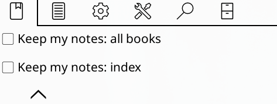
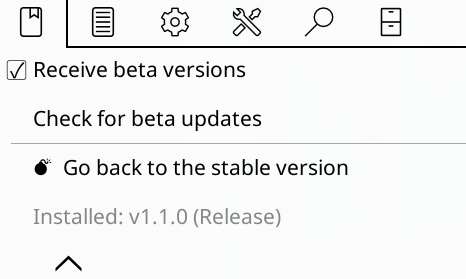

# Settings

[Back to the README](../README.md).

☰ menu → **Tomedown** → **Settings**, in five groups:

Everything here is stored in KOReader's settings and applies to every book.
The per-book choice and heading live in the book's own menu: see
[Keep my notes](keep-my-notes.md).

## Files

| Entry | What to do |
|---|---|
| *Local folder* | defaults to `clipboard/tomedown` inside KOReader's data folder; tap it to browse with KOReader's folder picker (long-press a folder to choose it) |
| *Create an index note (00 - Index.md)* | builds the Obsidian tables: a stats line on top, then series books and the rest, each with the columns it actually has (links, author, series, highlights with stars, status over the progress bar, last read) |
| *Include page bookmarks* | off by default: adds a `# Page bookmarks` section (bookmarked page + note) after the highlights |
| *Include book covers* | off by default: exports every cover into `covers/` and embeds it in the book file and in the index; the cover leaves the device after a successful upload, the vault copy is the master one. Requires **Obsidian 1.8.1 or newer** |
| *Export when I close a book* | off by default: exports the book when you close it, and again (silently, no network) before the device suspends |

Ticking or unticking *Include book covers* rewrites every already exported
file on the next export: the stored hash is invalidated, so *Export new and
changed books* re-sends everything once.

Covers are always exported in full colour, whatever the device: the
extraction forces colour rendering even on greyscale e-ink screens.

## Cloud

| Entry | What to do |
|---|---|
| *Upload to cloud* | any WebDAV/Dropbox/FTP server works; on by default for installs that have already exported, off on a fresh install |
| *Server and folder…* | opens the Cloud storage browser: pick your server (the examples use Koofr), then navigate to the final folder (e.g. `Bookshelf/Kindle`) and tap **Choose** |
| *Remote folder…* | only if you want to override the folder chosen above (e.g. `/Bookshelf/Kindle`) |

## My notes

| Entry | What to do |
|---|---|
| *Keep my notes: all books* | off by default (the tomedown ≤ 0.8 behaviour). Switch it on and every export folds the new render into your file, keeping your zones; switching modes rewrites every file on the next export. While it is on it alone is in charge: the keep row in *Current book* goes off, with *On for all books* on the right, the per-book heading and the index rows are hidden, and *Notes heading: %1* names every zone (see [Keep my notes](keep-my-notes.md)) |
| *Keep my notes: index* | the same switch for `00 - Index.md` alone, shown while the index is generated and *Keep my notes: all books* is off. It follows the global switch until you flip it, and no book turns it on any more |
| *Index notes heading: %1* | the heading of the index zone, below *Keep my notes: index* and only while the index keeps one. Tap to rename, empty means no heading; with *Keep my notes: all books* on, the global heading names it again |
| *Notes heading: %1* | the heading above your notes block, shown with *Keep my notes: all books* on. Tap to rename, empty means no heading. A book's own choice and heading live in the book's own menu |
| *Bring in edits made in Obsidian* | on by default: only shown while a server is set, *Upload to cloud* is on and *Keep my notes: all books* is on (there needs to be a write zone). Before folding the new highlights in, the export fetches the copy in the cloud and uses it as the base when it changed since the last upload, so notes written in Obsidian on the desktop survive (see [Editing in Obsidian while the device is away](keep-my-notes.md#editing-in-obsidian-while-the-device-is-away)) |

The group is rebuilt every time it opens, and in place when one of its
switches flips: a row that no longer applies leaves without closing the
menu.

## Highlights for Obsidian

| Entry | What to do |
|---|---|
| *Treat every highlight as special* | off by default: every highlight becomes an `> [!highlight]` callout instead of a plain quote; when off, only *Special Highlight* marks turn into callouts |
| *How special highlights look: %1* | only while the row above is off, since with every highlight a callout there is nothing left to choose (the row is grayed out): **Callout** is the default and keeps the box on the marked highlights alone, **Bold** writes them as `> **quote**` instead, for the readers that do not know callouts |
| *Add link IDs to highlights* | off by default: writes a stable `^hl-xxxxxxxx` id at the end of every quote, so Obsidian can link to one single highlight and embed it. See [File format](file-format.md#links-to-a-single-highlight) |

All three rows rewrite every already exported file on the next export:
none of them is part of the book's hash, so flipping one invalidates the
stored hashes, the way *Include book covers* does above.

## Updates

| Entry | What to do |
|---|---|
| *Check for updates (vX)* | the row doubles as the version display: it asks GitHub for newer stable releases, shows their notes and can install the update right away (**Update and restart**) |
| *View changelog* | pages through the notes of every release on GitHub, newest first; the list is cached when a check runs, so the viewer also works offline, and **Refresh** fetches it again |
| *Check for updates in background* | off by default: when enabled, a quiet check runs when KOReader starts and when the menu opens (at most once an hour) and notifies you of a new stable release |
| *Beta versions* | a submenu with everything that is not meant for daily use (below) |

### Beta versions

| Entry | What to do |
|---|---|
| *Receive beta versions* | off by default: while ticked, the *Check for beta updates* row below appears and the changelog lists prereleases (tags like `0.4.0-beta.1`) too |
| *Check for beta updates* | only visible while *Receive beta versions* is ticked: checks GitHub for newer prereleases right away and installs them the same way as a stable update |
| *Go back to the stable version* | installs the newest stable release even when your install is a beta newer than it (the way back from a beta); it also unticks *Receive beta versions* so the beta is not offered again |
| *Installed: vX (Release/Beta)* | the installed version as a plain label |

### How an update runs

*Check for updates (vX)* compares the installed version with the releases
on GitHub and shows the notes of **every** release newer than yours, so
someone updating from 0.2.0 to 1.0 reads the fixes of 0.3.0, 0.3.1 and 1.0
in one window. When your KOReader renders Markdown, the notes keep their
formatting (bold, headings, lists); older versions get them as plain text.
Tap **Update and restart**: the zip is downloaded, unpacked over the plugin
folder, and KOReader asks to restart. If the download or the unpacking
fails, the releases page opens instead so the zip can be taken by hand (see
[Install](../README.md#install)), which works from any older version.

Tick **Receive beta versions** (*Settings → Updates → Beta versions*) to
get the beta channel: a second **Check for beta updates** appears below the
box and offers prereleases (tags like `0.4.0-beta.1`). The check in
*Settings → Updates* stays on stable releases whatever the toggle says, and
unticking the box hides the beta check again. A beta install always sees the
final release of the same version, so checking from `0.4.0-beta.1` offers
`0.4.0`.

**Go back to the stable version** is the way back from a beta: it installs
the newest stable release even when your beta is newer than it (the check
only ever offers *newer* versions) and unticks *Receive beta versions* so
the same beta is not offered again.

When you publish a release, bump `version` in `_meta.lua` to the tag
without the `v`.

The updater is built to keep working from old installs: repository and API
URL never change, tags stay `vX.Y.Z` (prereleases `vX.Y.Z-beta.N`), release
zips keep the `tomedown.koplugin/` top-level folder, and settings keys are
never renamed.

## If you already use AnnotationSync

The cloud server is **inherited automatically** from the one AnnotationSync
already saved in KOReader (`Cloud settings`): *Server and folder…* shows
exactly that. If it is the right folder, you do not have to touch anything.
On a fresh install *Upload to cloud* starts off. Tick it once you are ready
to send the `.md` files (installs that have already exported keep it
ticked).

If AnnotationSync uploads its `.json` files somewhere other than where you
want the `.md` files (say `/Bookshelf/Kindle`), set **Remote folder…** and
type the correct path: it applies to this plugin only.

Tip: keep the `.md` files in a folder where AnnotationSync's JSONs do not
land, or add `*.json` to Remotely Save's *Ignore list* so only the notes
reach Obsidian.

The plugin **never touches** AnnotationSync's files (`<md5>.json`,
`settings_sync.json`): it only reads the `.sdr` folders.
